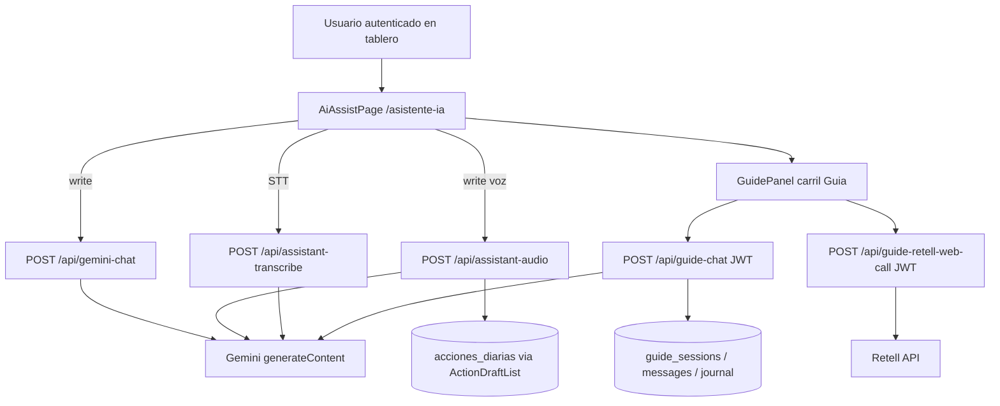
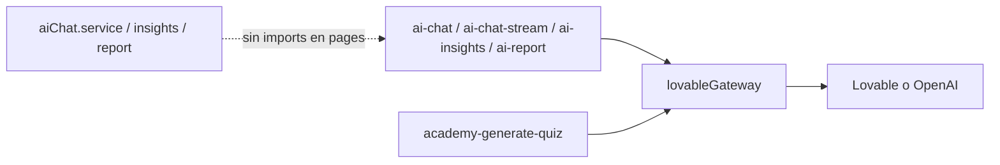
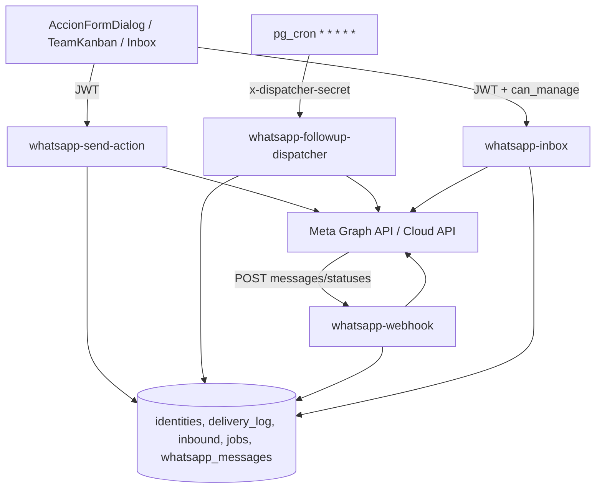

# Auditoría IA + WhatsApp — Scrumban

> Documento de solo lectura. Fecha de auditoría: 2026-11-03.  
> Convención de estado: **IMPLEMENTADO** · **CONFIGURADO** · **PARCIAL** · **PLANEADO** · **NO VERIFICADO**.  
> Regla: no se inventan consumos, tarifas ni capacidades sin evidencia en código, configuración o fuentes oficiales citadas.

---

## 1. Resumen ejecutivo

El producto expone un **Asistente IA** en `/asistente-ia` (chat Gemini + voz/borradores + Guía 15 min) y una integración **WhatsApp Cloud API** (envíos por acción, follow-ups, webhook, bandeja). Coexisten dos stacks de IA: el activo es **Vercel `/api/*` → Gemini directo**; las Edge Functions O2C (`ai-chat*`, `ai-insights`, `ai-report`) están **CONFIGURADAS** pero **sin UI principal** (salvo academia). WhatsApp está **IMPLEMENTADO** end-to-end vía Meta Graph; **no hay puente WhatsApp↔LLM**. No existe telemetría de tokens ni de costos en app. Riesgos altos: APIs Vercel de chat/audio **sin JWT**, webhook Meta **sin firma HMAC**, cron del dispatcher con URL hardcodeada a DEV. Costos reales: **NO VERIFICADOS** (faltan paneles Gemini/Meta); se aportan fórmulas y tarifas oficiales consultadas.

---

## 2. Estado actual

Funcionalidades **anidadas por dependencia** (padre → hijo). Sin el padre, el hijo no opera o pierde sentido.

### 2.1 Árbol — Asistente IA (producto `/asistente-ia`)

```text
Tablero autenticado + módulo ai_assist
└── Ruta /asistente-ia (AiAssistPage)                                          [IMPLEMENTADO]
    ├── Carril «Escribir» (chat operativo)
    │   ├── Contexto inyectado (depende de selección en UI)                    [IMPLEMENTADO]
    │   │   ├── boardContext ← acciones abiertas / resumen kanban
    │   │   ├── actionContext ← acción seleccionada + checklist/comentarios
    │   │   └── okrContext ← OKR / KR / iniciativa seleccionados
    │   ├── POST /api/gemini-chat → Gemini generateContent                    [IMPLEMENTADO]
    │   │   ├── System prompt (assistantPrompts)                               [IMPLEMENTADO]
    │   │   ├── Historial cliente (máx. ~24 msgs; no DB)                       [PARCIAL]
    │   │   ├── Persistencia conversación en DB                                [AUSENTE]
    │   │   └── Function calling / tools Gemini                                [AUSENTE]
    │   ├── Voz / borradores
    │   │   ├── POST /api/assistant-transcribe → Gemini STT                    [IMPLEMENTADO]
    │   │   ├── POST /api/assistant-audio → Gemini/Claude + JSON drafts        [IMPLEMENTADO]
    │   │   └── ActionDraftList → createActionFromDraft → acciones_diarias     [IMPLEMENTADO]
    │   │       └── persistGuideWork automático (sin callers)                  [PARCIAL / muerto]
    │   └── Alertas automáticas IA                                             [AUSENTE]
    │
    ├── Carril «Hablar» — Guía 15 min (GuidePanel)                             [IMPLEMENTADO]
    │   ├── Sesión guide_sessions (Supabase)                                   [IMPLEMENTADO]
    │   ├── Turno texto: POST /api/guide-chat → Gemini/Claude + board context  [IMPLEMENTADO]
    │   │   └── guide_messages                                                 [IMPLEMENTADO]
    │   ├── Voz: POST /api/guide-retell-web-call → Retell                      [IMPLEMENTADO]
    │   │   └── Cierre: transcript → guide-chat close                          [IMPLEMENTADO]
    │   ├── Cierre: executive_report + actionDrafts → guide_journal_entries    [IMPLEMENTADO]
    │   └── Historial /asistente-ia/historial (lee journal + messages)         [IMPLEMENTADO]
    │
    └── (Misma nav IA) Seguimiento WhatsApp — ver §2.2                         [IMPLEMENTADO UI]
        └── Puente LLM ↔ WhatsApp                                              [PARCIAL Fase 1: webhook → /api/whatsapp-assistant]
```

### 2.2 Árbol — WhatsApp Cloud API

```text
Identidad user_channel_identities (teléfono E.164)                             [IMPLEMENTADO]
├── Settings whatsapp_followup_settings (/settings/whatsapp)                   [IMPLEMENTADO]
│   └── Delays + plantillas de texto {{tokens}} (no son plantillas Meta)
│
├── Salida automatizada — Edge whatsapp-send-action                            [IMPLEMENTADO]
│   ├── Depende de: JWT + identidad WA del responsable + secrets Meta
│   ├── hasOpenSession ← external_inbound_messages < 24h                       [IMPLEMENTADO]
│   │   ├── Abierta → text | interactive (botones follow-up)
│   │   └── Cerrada → plantilla Meta WHATSAPP_INITIAL_TEMPLATE_*               [CONFIGURADO]
│   ├── messageType=initial → Graph + action_delivery_log + whatsapp_messages
│   │   └── Schedule whatsapp_followup_jobs (por checkpoint × followups/día) [IMPLEMENTADO]
│   ├── messageType=checkpoint_followup → Graph + log                          [IMPLEMENTADO]
│   └── messageType=commitment_close → Graph + log
│       └── Insert whatsapp_result_requests (waiting)                          [IMPLEMENTADO]
│
├── Cola — whatsapp_followup_jobs
│   └── pg_cron → whatsapp-followup-dispatcher                                 [IMPLEMENTADO / cron URL DEV]
│       └── Reutiliza hasOpenSession + Graph + dual-write log/hilo
│
├── Entrada — whatsapp-webhook                                                 [IMPLEMENTADO]
│   ├── GET hub.verify_token                                                   [IMPLEMENTADO]
│   ├── POST X-Hub-Signature-256                                               [AUSENTE]
│   ├── value.messages
│   │   ├── Dedup external_update_id = Meta message.id                         [IMPLEMENTADO]
│   │   ├── Insert external_inbound_messages + whatsapp_messages               [IMPLEMENTADO]
│   │   ├── Botones/texto → actualizar checkpoint / estado acción              [IMPLEMENTADO]
│   │   ├── Evidencia (si result_request waiting) → Storage + comentarios      [IMPLEMENTADO]
│   │   ├── Auto-reply Graph → whatsapp_messages (automation)                  [IMPLEMENTADO post-cambio]
│   │   └── Texto libre OKRS → APP_URL/api/whatsapp-assistant (flag)           [PARCIAL Fase 1]
│   └── value.statuses → delivery_status en whatsapp_messages                  [IMPLEMENTADO]
│       └── delivered / read / failed (monotonic)
│
└── Bandeja operador — /asistente-ia/seguimiento-whatsapp                      [IMPLEMENTADO]
    ├── Depende de: can_manage_catalogs / whatsapp_inbox_can_access
    ├── RPCs list_conversations / list_messages / list_contacts                [IMPLEMENTADO]
    ├── Realtime/poll sobre whatsapp_messages                                  [IMPLEMENTADO]
    └── Edge whatsapp-inbox
        ├── compose_options (ventana + plantillas)                             [IMPLEMENTADO]
        └── send texto|plantilla (client_request_id idempotente)               [IMPLEMENTADO]
            └── Solo escribe whatsapp_messages (no action_delivery_log)
```

### 2.3 Árbol — IA satélite (fuera del asistente principal)

```text
Academia
└── academy-generate-quiz → lovableGateway                                     [IMPLEMENTADO]

Stack O2C Edge (ai-chat / stream / insights / report)
└── Servicios cliente existen; UI principal no los invoca                      [CONFIGURADO]
```

### 2.4 Matriz rápida padre → hijo crítico

| Padre | Hijo depende de | Si falta el padre |
| --- | --- | --- |
| Identidad WA | Cualquier envío / bandeja al contacto | `whatsapp_identity_missing` |
| Inbound reciente (<24h) | Texto libre / interactive | Obliga plantilla Meta |
| `initial` exitoso + settings | Jobs de follow-up | No hay seguimientos programados |
| Botón «Realizada» + result_request | Flujo evidencia | Media/texto no se archivan como evidencia |
| `whatsapp_messages` + migración inbox | Bandeja / estados Meta en UI | Hilo vacío o error RPC |
| Módulo `ai_assist` + rol | `/asistente-ia` | Redirect / ítem oculto |
| `can_manage_catalogs` | Bandeja + vincular teléfono | 403 / RPC denegado |
| `GEMINI_API_KEY` | Chat / audio / transcribe / Guía Gemini | 500 en `/api/*` |
| `WHATSAPP_AI_ENABLED` + secreto + `APP_URL` | Chatbot Gemini en WhatsApp | Silencio; checkpoints/evidencia siguen igual |
| Secrets Meta | Todo Graph | `missing_whatsapp_secrets` / Graph 4xx |

---

## 3. Arquitectura del Asistente IA

### 3.1 Diagrama (stack activo)



### 3.2 Stack CONFIGURADO no usado por UI principal



### 3.3 Funcionalidades del asistente (detalle por anidación)

Detalle del árbol §2.1. Cada fila es un nodo; **Depende de** = padre inmediato.

| Nodo | Depende de | Qué hace / datos → salida | Estado | Limitaciones |
| --- | --- | --- | --- | --- |
| `/asistente-ia` | Auth + módulo `ai_assist` | Shell de carriles Escribir / Hablar | IMPLEMENTADO | Analista estricto bloqueado |
| Chat Gemini | Carril Escribir | Asesorar tablero/ejecución/logística | IMPLEMENTADO | No escribe DB |
| └ boardContext | Chat + resumen kanban | Priorizar / desbloquear | IMPLEMENTADO | Truncado `MAX_BOARD_CONTEXT_CHARS` |
| └ actionContext | Chat + acción seleccionada | Checklist, evidencia, cierre recomendado | IMPLEMENTADO | No cierra acciones |
| └ okrContext | Chat + OKR/KR seleccionado | Calidad objetivo/KR/iniciativa | IMPLEMENTADO | No muta OKRs |
| └ consejo KPI | Prompt + pregunta usuario | OTIF, lead time, etc. | IMPLEMENTADO | No lee tablas KPI en vivo |
| Transcribe | Carril Escribir | Audio → texto | IMPLEMENTADO | Sin JWT en API |
| Audio + drafts | Carril Escribir | JSON `actionDrafts` | IMPLEMENTADO | Sin JWT en API |
| └ Aprobar draft | Audio/Guía drafts | Insert `acciones_diarias` | IMPLEMENTADO | Manual |
| Guía sesión | Carril Hablar | Reloj 15 min + `guide_sessions` | IMPLEMENTADO | — |
| └ Turno texto | Sesión Guía | `guide-chat` + board | IMPLEMENTADO | — |
| └ Voz Retell | Sesión Guía | Web call + cierre transcript | IMPLEMENTADO | — |
| └ Diario | Cierre Guía | `guide_journal_entries` | IMPLEMENTADO | — |
| └ Historial | Diario | `/asistente-ia/historial` | IMPLEMENTADO | Chat Gemini no aparece aquí |
| Alertas IA | — | — | AUSENTE | — |
| WhatsApp vía LLM | — | — | AUSENTE | Solo nav compartida |

Prompts y límites: `src/lib/assistantPrompts.ts` (`MAX_CONTEXT_MESSAGES = 8`, `MAX_BOARD_CONTEXT_CHARS = 2800`, `MAX_OKR_CONTEXT_CHARS = 3500`, `MAX_ACTION_CONTEXT_CHARS = 1800`).

### 3.4 Integración Gemini (IMPLEMENTADO en Vercel)

| Parámetro | Valor en código | Archivo |
| --- | --- | --- |
| Endpoint | `https://generativelanguage.googleapis.com/v1beta/models/{model}:generateContent` | `api/gemini-chat.ts` L36–37, L143 |
| Modelo default | `gemini-2.5-flash-lite` | L37 |
| maxOutputTokens | `GEMINI_MAX_TOKENS` default **700** | L38–39, L162 |
| temperature | default **0.25** | L39, L163 |
| timeout | default **20000 ms** | L40, L145 |
| Auth del handler | **Ninguna** (solo valida body) | L84–128 |
| Clave | `GEMINI_API_KEY` solo servidor | L92–97 |
| Streaming | No | — |
| Function calling | No | — |
| Embeddings / vector DB | No hallado | AUSENTE |
| Caché de contexto Gemini | No usado en código | AUSENTE |

Otros modelos en código: `gemini-2.5-flash` (transcribe), `claude-sonnet-4-20250514` (audio/guía opcional), Edge `google/gemini-3-flash-preview` / `gpt-4o-mini` vía `lovableGateway.ts`.

### 3.5 Consumo de recursos IA

**Qué genera consumo (IMPLEMENTADO):** cada `POST` a `/api/gemini-chat`, `/api/assistant-audio`, `/api/assistant-transcribe`, `/api/guide-chat` (turno/cierre), y Edge academia/O2C si se invocan.

**Instrumentación:** **AUSENTE**. Solo `console.error` con status/modelo (`gemini-chat.ts` L175–178). No hay tabla de usage, tokens, usuario ni costo.

**Fórmula de estimación (simulada):**  
`costo ≈ (tokens_in / 1e6) * P_in + (tokens_out / 1e6) * P_out`  
con `tokens_in ≈ len(system + historial + contextos)/4` (heurística; **NO VERIFICADO** como medición real).

---

## 4. Arquitectura de WhatsApp

### 4.1 Diagrama



**Proveedor:** Meta WhatsApp **Cloud API directa** (IMPLEMENTADO). No hay Twilio/BSP en el código WhatsApp.

### 4.2 Automatizaciones (anidadas)

Misma jerarquía que §2.2, con disparador y efecto:

| Nivel | Flujo | Depende de | Disparador | Tipo mensaje | Resultado |
| --- | --- | --- | --- | --- | --- |
| 1 | Identidad WA | Usuario activo | Admin vincula teléfono | — | `user_channel_identities` |
| 2 | Envío `initial` | Identidad + secrets | Crear/asignar / botón WA | Texto o plantilla Meta | Log + hilo + **jobs** |
| 3 | Jobs follow-up | `initial` + settings | Cron dispatcher / botón UI | Interactive o plantilla | Log + job `sent`/`failed` |
| 2 | Envío `commitment_close` | Identidad | Botón cierre | Texto o plantilla | Log + **result_request waiting** |
| 3 | Evidencia | result_request waiting | Inbound texto/media post-«Realizada» | — | Storage + comentario → `received` |
| 2 | Inbound botones/texto | Webhook + dedup | Meta `messages` | — | Actualiza checkpoint/estado + auto-reply |
| 2 | Statuses Meta | `meta_message_id` en hilo | Meta `statuses` | — | `delivered` / `read` / `failed` |
| 2 | Bandeja manual | Operador + identidad | Inbox compose/send | Texto o plantilla | Solo `whatsapp_messages` |

Ventana 24h: `hasOpenSession` = existe fila en `external_inbound_messages` últimas 24h para ese `wa_id` (p. ej. `whatsapp-send-action/index.ts` L155–165). Es **prerrequisito** del texto libre e interactive; si falla, todos los envíos caen a plantilla Meta.

### 4.3 Plantillas Meta

| Plantilla | Categoría | Evento | Variables (código) | Idioma default código | Estado Meta | Archivo |
| --- | --- | --- | --- | --- | --- | --- |
| `nueva_actividad_what2do` (env `WHATSAPP_INITIAL_TEMPLATE_NAME`) | Inferida UTILITY en ops previas; **aprobación en runtime no leída por la app** | Fallback fuera de 24h (initial/followup/close/inbox) | 3 body params (nombre, título/asunto, fecha/detalle) | `en` | CONFIGURADO en secrets/env; aprobación **externa a verificar en Business Manager** | `whatsapp-send-action` L103–104; inbox L93–94 |
| Plantillas de texto internas DB | N/A (no son plantillas Meta) | Cuerpo cuando hay ventana | `{{responsable_nombre}}`, etc. | N/A | IMPLEMENTADO en `whatsapp_followup_settings` | Migración `20261103120000_…`, Settings UI |

**Riesgo de reclasificación:** el uso es recordatorio/seguimiento operativo → típico **Utility**. Si el copy se vuelve promocional, Meta puede reclasificar a Marketing (mayor tarifa). **NO VERIFICADO** el copy exacto aprobado en Meta desde este repo.

### 4.4 Volumen y anti-abuso

- Follow-ups: `followups_per_day` (0–12) × checkpoints pendientes × delay minutos (`whatsapp_followup_settings`).
- Dispatcher: hasta **20** jobs por invocación (`whatsapp-followup-dispatcher`).
- Dedup inbound: índice único `(channel, external_update_id)`.
- Dedup envío inbox: `client_request_id`.
- Rate limits Meta: **no implementados** en app (dependen de Graph).
- Un mismo evento puede programar **N** follow-ups (uno por checkpoint × `followups_per_day`) — potencial de volumen alto si hay muchos checkpoints.

---

## 5. Inventario de dependencias y servicios externos

| Servicio | Finalidad | Entorno | Costo asociado |
| --- | --- | --- | --- |
| Google Gemini API | Chat, audio, transcribe, Guía | Vercel/server | Por tokens (ver §6) |
| Anthropic Claude | Alternativa audio/Guía si provider | Vercel | Por tokens; **CONFIGURADO** |
| Retell | Voz Guía | Vercel + cliente | Plan Retell; **CONFIGURADO** |
| Lovable / OpenAI gateway | Edge O2C / academia | Supabase Edge | Créditos Lovable / OpenAI; **CONFIGURADO** |
| Meta Graph WhatsApp | Mensajería | Edge Functions | Por mensaje entregado (ver §6) |
| Supabase (DB, Auth, Storage, Edge, cron) | Persistencia e infra | Cloud | Plan Supabase |
| Vercel | Hosting + `/api` | Cloud | Plan Vercel |

---

## 6. Análisis de costos

### 6.1 Clasificación

| Tipo | Disponibilidad |
| --- | --- |
| Costos medidos (billing real) | **NO VERIFICADO** — sin acceso a facturas Gemini/Meta/Retell en esta auditoría |
| Costos calculados | Solo si se aportan métricas de uso × tarifas oficiales |
| Costos simulados | Escenarios abajo con supuestos editables |
| Tarifas | Consultadas en fuentes oficiales (citadas); validar vigencia en panel |

### 6.2 Gemini — tarifas de referencia

Fuente: [Gemini API pricing](https://ai.google.dev/gemini-api/docs/pricing) (consultada 2026-11-03).

Modelo default del producto: **`gemini-2.5-flash-lite`**.

| Concepto | Paid tier (USD / 1M tokens) |
| --- | --- |
| Input (text/image/video) | **$0.10** |
| Output (incluye thinking) | **$0.40** |

> Nota Google: acceso a modelos 2.5 puede estar limitado a cuentas con uso previo; validar en consola del proyecto (**NO VERIFICADO** para esta cuenta).

**Fórmula:**  
`C_gemini_mes = N_req × ((Tin/1e6)×0.10 + (Tout/1e6)×0.40)`  
donde `N_req`, `Tin`, `Tout` deben medirse (hoy **no** se miden).

### 6.3 WhatsApp — tarifas de referencia (México +52)

Fuente: [Pricing WhatsApp Business Platform](https://developers.facebook.com/documentation/business-messaging/whatsapp/pricing) y rate card efectiva **2026-10-01** (resúmenes públicos alineados a Meta).

Modelo actual Meta: **cobro por mensaje entregado** (no por “conversación” legacy), categoría × mercado.

| Categoría (México) | USD / mensaje entregado (lista) | Notas |
| --- | --- | --- |
| Utility | **~$0.0085** | Aplicable a plantillas utility |
| Service | **~$0.0085** | Tras **1,000** service gratis/mes/número |
| Marketing | **~$0.0397** | No usado por el código actual |
| User → business | **$0** | Inbound no cobrado por Meta |

**Fórmula:**  
`C_wa_mes ≈ U_delivered × 0.0085 + max(0, S_delivered − 1000) × 0.0085`  
(`U` = utility templates; `S` = service/text dentro de ventana).

Volumen tiers utility (México) empiezan tras ~1M msgs/mes — irrelevante a escala actual típica SaaS mediana (**simulación**).

### 6.4 Escenarios simulados (editables)

**Supuestos base (EDITABLES — no son mediciones):**

| Variable | Bajo | Medio | Alto |
| --- | --- | --- | --- |
| % usuarios activos | 40% | 60% | 80% |
| Consultas Gemini / usuario activo / día | 1 | 3 | 8 |
| Tokens in / consulta | 2,000 | 4,000 | 8,000 |
| Tokens out / consulta | 300 | 500 | 800 |
| Msgs WA utility / usuario activo / día | 0.5 | 2 | 5 |
| Msgs WA service / usuario activo / día | 0.2 | 1 | 3 |
| Días operativos / mes | 22 | 22 | 22 |

**Gemini (USD/mes) ≈**  
`usuarios × activo × consultas/día × 22 × ((Tin/1e6)×0.10 + (Tout/1e6)×0.40)`

**WhatsApp (USD/mes) ≈**  
`usuarios × activo × ((U/día)×22×0.0085 + max(0, S_mes − 1000)×0.0085)`  
con `S_mes = usuarios×activo×(S/día)×22` (1k free por número de negocio, no por usuario).

#### Tabla de simulación (Gemini + WA Meta, sin Retell/Supabase/Vercel)

| Usuarios | Escenario | Gemini est. USD | WA Meta est. USD | Total est. USD | USD / usuario activo* |
| --- | --- | --- | --- | --- | --- |
| 28 | Bajo | ~0.99 | ~1.30 | ~2.3 | ~0.20 |
| 28 | Medio | ~8.3 | ~6.9 | ~15 | ~0.90 |
| 28 | Alto | ~49 | ~26 | ~75 | ~3.3 |
| 50 | Bajo | ~1.8 | ~2.3 | ~4.1 | ~0.20 |
| 50 | Medio | ~15 | ~12 | ~27 | ~0.90 |
| 50 | Alto | ~88 | ~47 | ~135 | ~3.4 |
| 100 | Bajo | ~3.5 | ~4.7 | ~8.2 | ~0.21 |
| 100 | Medio | ~30 | ~25 | ~55 | ~0.91 |
| 100 | Alto | ~176 | ~93 | ~269 | ~3.4 |
| 250 | Bajo | ~8.8 | ~12 | ~21 | ~0.21 |
| 250 | Medio | ~74 | ~62 | ~136 | ~0.91 |
| 250 | Alto | ~440 | ~233 | ~673 | ~3.4 |

\*Usuario activo = usuarios × % activo del escenario. Cifras **simuladas** con supuestos de la tabla; redondeo aproximado.  
**No incluyen:** Retell, Claude, Lovable, Vercel, Supabase, impuestos, reintentos Graph, ni free tier Gemini.

---

## 7. Seguridad y riesgos

| ID | Hallazgo | Severidad | Evidencia |
| --- | --- | --- | --- |
| S1 | `/api/gemini-chat`, `/api/assistant-audio`, `/api/assistant-transcribe` sin autenticación JWT | **Crítico** | `api/gemini-chat.ts` sin checks de auth; `assistant-transcribe` documenta ausencia |
| S2 | Webhook WhatsApp POST sin `X-Hub-Signature-256` | **Alto** | `whatsapp-webhook/index.ts` acepta JSON sin HMAC |
| S3 | `verify_jwt = false` en Edge WA; auth interna variable (send/inbox sí; webhook no) | **Medio** | `supabase/config.toml` |
| S4 | Dispatcher abierto si `WHATSAPP_DISPATCHER_SECRET` vacío | **Alto** | `whatsapp-followup-dispatcher` L255–259 |
| S5 | Cron hardcodeado a proyecto DEV | **Alto** (ops) | `20261103121000_whatsapp_followup_dispatcher_cron.sql` L20 |
| S6 | Datos de tablero/OKRs/acciones enviados a Gemini (PII laboral) | **Medio** | Context builders + prompts |
| S7 | Prompt injection: mitigado parcialmente por reglas de alcance | **Medio** | `assistantPrompts.ts` SHARED_RULES; no sandbox |
| S8 | Bandeja WA gated por `can_manage_catalogs` / Dirección+ | **Bajo** (control OK) | RPCs + `permissions.ts` |
| S9 | Secrets solo en servidor (no `VITE_` para Meta/Gemini) | **OK** | `.env.example` |
| S10 | Sin cuotas por usuario de IA | **Medio** | AUSENTE instrumentación |
| S11 | Docs drift (`es_MX`, `app_settings`, piezas Guía Edge) | **Bajo** | `docs/whatsapp.md`, `docs/guia.md` vs código |

---

## 8. Oportunidades de optimización

| Mejora | Problema | Beneficio | Impacto costo | Esfuerzo | Prioridad |
| --- | --- | --- | --- | --- | --- |
| Autenticar `/api/gemini-chat` y audio | Abuso de cuota | Seguridad + costo | Alto ↓ abuso | Bajo | P0 |
| Firmar webhook Meta + secret dispatcher obligatorio | Eventos/jobs falsos | Integridad | Medio | Bajo | P0 |
| Telemetría tokens + usuario + modelo | Ciego FinOps | Decisiones de costo | Enabler | Medio | P0 |
| Acotar historial/contextos ya limitados + medir Tin real | Tokens altos | ↓ Gemini | Medio | Bajo | P1 |
| Agrupar follow-ups / tope por usuario/día | N msgs × checkpoints | ↓ WA utility | Alto potencial | Medio | P1 |
| Preferencias opt-in WhatsApp | Spam operativo | Compliance + ↓ msgs | Medio | Medio | P1 |
| Desconectar o documentar Edge O2C muerto | Confusión / surface attack | Claridad | Bajo | Bajo | P2 |
| Auth en todas las APIs Vercel IA | Paridad con Guía | Seguridad | Alto | Bajo | P0 |
| Cachear respuestas triviales / FAQ | Consultas repetidas | ↓ Gemini | Bajo–Medio | Medio | P2 |
| Corregir cron URL por entorno | Jobs en proyecto equivocado | Ops | Riesgo prod | Bajo | P0 |

---

## 9. Backlog priorizado

### Quick wins

| Acción | Justificación | Componentes | Beneficio | Complejidad | Dependencias | Criterio de aceptación |
| --- | --- | --- | --- | --- | --- | --- |
| JWT en `gemini-chat` / audio / transcribe | S1 | `api/*` | Cierra abuso anónimo | Baja | Auth Supabase | Sin Bearer → 401; con sesión → 200 |
| `WHATSAPP_DISPATCHER_SECRET` obligatorio | S4 | dispatcher + Vault + cron | Solo cron dispara | Baja | Vault | POST sin header → 401 |
| HMAC webhook | S2 | `whatsapp-webhook` | Solo Meta válido | Baja | App secret Meta | Firma inválida → 401 |
| Secrets plantilla `nueva_actividad_what2do` + `en` | Errores 132001 | Supabase secrets | Envios OK | Baja | Meta BM | Graph acepta template |
| Cron URL por proyecto | S5 | migración cron | Jobs en el entorno correcto | Baja | Ops | Job apunta al project-ref activo |

### Mejoras estructurales

| Acción | Justificación | Componentes | Beneficio | Complejidad | Criterio |
| --- | --- | --- | --- | --- | --- |
| Tabla `ai_usage_events` | FinOps | API + migración | Costo por usuario | Media | Cada request registra tokens/modelo/usuario |
| Cap diario IA por rol | S10 | API | Presupuesto | Media | 429 al superar cuota |
| Tope follow-ups + digest | Volumen WA | send-action, settings | ↓ msgs | Media | Máx N msgs/usuario/día configurable |
| Dual-write inbox → delivery_log opcional | Consistencia audit | inbox | Un solo audit trail | Baja | Manual send visible en audit SQL |

### Evolución futura

| Acción | Estado hoy | Nota |
| --- | --- | --- |
| Chatbot WhatsApp con LLM | AUSENTE | Reusar `whatsapp_messages` con `source=automation` |
| Tool-calling para mutaciones | AUSENTE | Hoy solo drafts |
| Persistencia chat operativo | AUSENTE | Solo Guía |
| Activar UI Edge O2C o retirar código | CONFIGURADO sin uso | Reducir deuda |

---

## 10. Información pendiente de verificar

1. Facturación real Gemini (AI Studio / Cloud Billing) — tokens y USD del mes.
2. Facturación Meta WhatsApp (Business Manager → billing) — msgs por categoría/mercado.
3. Plan y consumo Retell / Claude / Lovable.
4. Estado de aprobación y cuerpo exacto de `nueva_actividad_what2do` en Business Manager (variables, botones).
5. Si el secret `WHATSAPP_INITIAL_TEMPLATE_*` ya está aplicado en DEV/PROD.
6. Si el cron de prod apunta al project-ref correcto.
7. Volumen histórico: filas/mes en `action_delivery_log` y `whatsapp_messages`.
8. Número de usuarios activos reales con identidad WhatsApp.
9. Si `/api/*` de Vercel está expuesto públicamente sin WAF/auth de edge.
10. Free tier Gemini vigente para la cuenta del proyecto.

---

## 11. Anexo técnico

### 11.1 Inventario de componentes

| Componente | Función | Estado | Tecnología | Ubicación |
| --- | --- | --- | --- | --- |
| AiAssistPage | UI asistente | IMPLEMENTADO | React | `src/features/ai-support/pages/AiAssistPage.tsx` |
| GuidePanel | Guía texto/voz | IMPLEMENTADO | React + Retell SDK | `src/features/guide/components/GuidePanel.tsx` |
| AiHistoryPage | Historial Guía | IMPLEMENTADO | React | `src/features/ai-support/pages/AiHistoryPage.tsx` |
| WhatsAppSeguimientoPage | Bandeja WA | IMPLEMENTADO | React | `src/features/whatsapp-inbox/pages/WhatsAppSeguimientoPage.tsx` |
| gemini-chat | Proxy Gemini | IMPLEMENTADO | Vercel/Node | `api/gemini-chat.ts` |
| assistant-audio | Voz + drafts | IMPLEMENTADO | Vercel | `api/assistant-audio.ts` |
| assistant-transcribe | STT | IMPLEMENTADO | Vercel | `api/assistant-transcribe.ts` |
| guide-chat | Turnos/cierre Guía | IMPLEMENTADO | Vercel | `api/guide-chat.ts` |
| guide-retell-web-call | Token Retell | IMPLEMENTADO | Vercel | `api/guide-retell-web-call.ts` |
| assistantPrompts | System prompts | IMPLEMENTADO | TS | `src/lib/assistantPrompts.ts` |
| ai-chat / stream / insights / report | O2C Edge | CONFIGURADO | Deno Edge | `supabase/functions/ai-*` |
| lovableGateway | Gateway LLM | CONFIGURADO | Deno | `supabase/functions/_shared/lovableGateway.ts` |
| academy-generate-quiz | Quiz academia | IMPLEMENTADO | Edge | `supabase/functions/academy-generate-quiz` |
| whatsapp-send-action | Envío acciones | IMPLEMENTADO | Edge | `supabase/functions/whatsapp-send-action` |
| whatsapp-webhook | Inbound/status | IMPLEMENTADO | Edge | `supabase/functions/whatsapp-webhook` |
| whatsapp-followup-dispatcher | Jobs | IMPLEMENTADO | Edge | `supabase/functions/whatsapp-followup-dispatcher` |
| whatsapp-inbox | Envío manual | IMPLEMENTADO | Edge | `supabase/functions/whatsapp-inbox` |
| whatsappIntegration.service | Cliente WA | IMPLEMENTADO | TS | `src/services/whatsappIntegration.service.ts` |
| WhatsAppSettingsPage | Delays/templates texto | IMPLEMENTADO | React | `src/features/settings/pages/WhatsAppSettingsPage.tsx` |
| UserWhatsAppCard | Vincular teléfono | IMPLEMENTADO | React | `src/features/users/components/UserWhatsAppCard.tsx` |

### 11.2 Migraciones utilizadas (runtime)

| Migración | Qué aporta en uso |
| --- | --- |
| `supabase/migrations/20260619035859_action_close_rpc_and_telegram.sql` | Base `user_channel_identities`, `action_delivery_log`, `external_inbound_messages` |
| `supabase/migrations/20261101120000_create_guide_companion.sql` | `guide_sessions`, `guide_messages`, `guide_journal_entries` |
| `supabase/migrations/20261103120000_whatsapp_channel_support.sql` | Canal WhatsApp, `whatsapp_followup_settings`, `whatsapp_followup_jobs`, `whatsapp_result_requests` |
| `supabase/migrations/20261103121000_whatsapp_followup_dispatcher_cron.sql` | `pg_cron` → `whatsapp-followup-dispatcher` |
| `supabase/migrations/20261103130000_whatsapp_identity_manage_catalogs.sql` | RPCs `admin_upsert_whatsapp_identity` / `admin_clear_whatsapp_identity` |
| `supabase/migrations/20261103140000_guide_journal_executive_report.sql` | Columnas diario Guía (`executive_report`, etc.) |
| `supabase/migrations/20261103150000_whatsapp_inbox.sql` | `whatsapp_messages` + RPCs bandeja + `whatsapp_inbox_can_access` |
| `supabase/migrations/20260715180000_role_module_permissions_and_multi_role.sql` | Módulo catálogo `ai_assist` (gating de rutas IA) |

### 11.3 Tablas y RPCs utilizados

| Tabla / RPC | Rol |
| --- | --- |
| `guide_sessions`, `guide_messages`, `guide_journal_entries` | Persistencia Guía |
| `user_channel_identities` | Teléfono WhatsApp vinculado |
| `action_delivery_log` | Outbound de acciones / dispatcher |
| `external_inbound_messages` | Inbound raw + detección ventana 24 h |
| `whatsapp_followup_settings` | Delays y plantillas de texto |
| `whatsapp_followup_jobs` | Cola de follow-ups |
| `whatsapp_result_requests` | Espera de evidencia |
| `whatsapp_messages` | Hilo unificado de la bandeja |
| `admin_upsert_whatsapp_identity` / `admin_clear_whatsapp_identity` | Vincular / revocar teléfono |
| `whatsapp_inbox_list_conversations` | Lista de hilos |
| `whatsapp_inbox_list_messages` | Historial paginado |
| `whatsapp_inbox_list_contacts` | Contactos con WA para «Nueva conversación» |
| `whatsapp_inbox_session_open` | ¿Ventana 24 h abierta? |
| `whatsapp_inbox_can_access` | Gate de operadores en Edge inbox |

### 11.4 Funciones y endpoints utilizados

| Función / endpoint | Quién la llama | Auth |
| --- | --- | --- |
| `POST /api/gemini-chat` | `AiAssistPage` | **Sin JWT** |
| `POST /api/assistant-audio` | Panel de voz del asistente | **Sin JWT** |
| `POST /api/assistant-transcribe` | STT del asistente | **Sin JWT** |
| `POST /api/guide-chat` | Guía (turnos + cierre) | JWT Bearer |
| `POST /api/guide-retell-web-call` | Guía voz | JWT Bearer |
| Edge `whatsapp-send-action` | Acciones corporativas / equipos / cierre | JWT sesión |
| Edge `whatsapp-webhook` | Meta (inbound + statuses) | GET verify token; POST **sin HMAC** |
| Edge `whatsapp-followup-dispatcher` | `pg_cron` | `x-dispatcher-secret` si está configurado |
| Edge `whatsapp-inbox` | Bandeja (compose + send) | JWT + `whatsapp_inbox_can_access` |
| Edge `academy-generate-quiz` | Academia (IA aparte del asistente) | JWT + super_admin |

**Presentes en repo pero no usados por la UI principal del asistente:** Edge `ai-chat`, `ai-chat-stream`, `ai-insights`, `ai-report`, `lovable-chat-completions` (gateway sí lo usa academia).

### 11.5 Rutas de producto utilizadas

| Ruta | Constante | Pantalla | Nav |
| --- | --- | --- | --- |
| `/asistente-ia` | `ROUTES.AI_ASSIST` | Asistente + Guía | Sidebar → IA → Asistente |
| `/asistente-ia/historial` | `ROUTES.AI_HISTORY` | Historial Guía | Sidebar → IA → Historial |
| `/asistente-ia/seguimiento-whatsapp` | `ROUTES.AI_WHATSAPP_SEGUIMIENTO` | Bandeja WhatsApp | Sidebar → IA → Seguimiento WhatsApp |
| `/settings/whatsapp` | `ROUTES.SETTINGS_WHATSAPP` | Delays + plantillas de texto | Settings → WhatsApp |

Registro: `src/routes/index.tsx`. Constantes: `src/constants/index.ts`. Ítems IA: `src/components/layout/Sidebar.tsx`.

### 11.6 Accesos (quién puede usar qué)

| Recurso | Quién puede acceder | Evidencia |
| --- | --- | --- |
| `/asistente-ia` y `/asistente-ia/historial` | Operativo / Dirección / admins con módulo `ai_assist`. **Analista estricto: no** | `permissions.ts` (`ANALYST_ALLOWED_ROUTES`, `STRICT_ANALYST_*`); `moduleAccess.ts` → `ai_assist` |
| `/asistente-ia/seguimiento-whatsapp` | Dirección / DG / Sistemas / super_admin / app admin; módulo `settings_reminders`. **Operativo y Analista: no** | `permissions.ts` gate explícito; `moduleAccess.ts` |
| `/settings/whatsapp` | Familia Dirección+; RLS settings con `is_app_admin` / `is_business_admin` | `DIRECTION_ALLOWED_ROUTES`; migración settings WA |
| Vincular / desvincular WhatsApp (usuario) | `can_manage_catalogs()` | RPC `admin_*_whatsapp_identity` |
| Lectura/envío bandeja (RPC + Edge inbox) | Equivalente a gestores de catálogo (`whatsapp_inbox_can_access`) | `20261103150000_whatsapp_inbox.sql`, `whatsapp-inbox` |
| `/api/gemini-chat`, `/api/assistant-audio`, `/api/assistant-transcribe` | Cualquier cliente que alcance el endpoint (sin auth de app) | Handlers en `api/` |
| `/api/guide-chat`, `/api/guide-retell-web-call` | Usuario con sesión Supabase (JWT) | Handlers Guía |
| `whatsapp-send-action` | Usuario autenticado (JWT); **sin** check de rol de negocio adicional en la función | `requireAuthUser` |
| `whatsapp-webhook` | Meta (verify token en GET); POST abierto a quien conozca la URL | Sin firma HMAC |
| `whatsapp-followup-dispatcher` | Cron con secret; si el secret está vacío, el POST no queda cerrado | Header `x-dispatcher-secret` |

### 11.7 Variables de entorno (nombres)

IA: `GEMINI_API_KEY`, `GEMINI_MODEL`, `GEMINI_MAX_TOKENS`, `GEMINI_TEMPERATURE`, `GEMINI_TIMEOUT_MS`, `GEMINI_TRANSCRIBE_MODEL`, `ASSISTANT_AUDIO_PROVIDER`, `ANTHROPIC_API_KEY`, `CLAUDE_*`, `GUIDE_PROVIDER`, `GUIDE_*`, `RETELL_API_KEY`, `RETELL_GUIDE_AGENT_ID`, `LOVABLE_API_KEY`, `OPENAI_*`.  
WhatsApp: `WHATSAPP_ACCESS_TOKEN`, `WHATSAPP_PHONE_NUMBER_ID`, `WHATSAPP_VERIFY_TOKEN`, `WHATSAPP_GRAPH_VERSION`, `WHATSAPP_INITIAL_TEMPLATE_NAME`, `WHATSAPP_INITIAL_TEMPLATE_LANGUAGE`, `WHATSAPP_DISPATCHER_SECRET`, `WHATSAPP_BUSINESS_ACCOUNT_ID` (docs/ops).

### 11.8 Docs existentes (parcialmente desfasados)

- `docs/whatsapp.md`, `docs/asistente-ia-gemini.md`, `docs/guia.md`, `docs/ia.md`, `docs/voz.md`, `docs/environment-variables.md`, `docs/vercel-env.md`.

### 11.9 Contradicciones doc ↔ código

| Tema | Doc | Código |
| --- | --- | --- |
| Idioma plantilla default | `es_MX` en partes de `whatsapp.md` | Default **`en`** |
| Settings WA | `app_settings` histórico | Tabla `whatsapp_followup_settings` |
| Guía Edge webhook | Documentado en `guia.md` | **No existe** en `supabase/functions` |
| `AI_PROVIDER` | Mencionado en algunos envs locales | **No** referenciado en código TS |

---

*Fin del documento de auditoría. Ningún cambio de código, secretos ni despliegues fue ejecutado como parte de esta entrega de documentación.*
