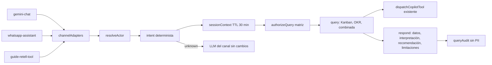
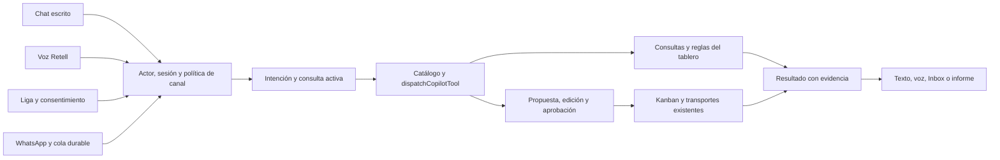

# Enviardián · arquitectura objetivo

## R2 · agente accionable (local) · actualizado con QA controlado · 2026-11-19

R2 reutiliza `ACTION_CONTRACTS`, `R2_PHASE_MATRIX`, `assistant_pending_ops` y `confirmPendingOp`; no hay otro sistema de confirmaciones ni un segundo motor de ejecución.

| Fase | Dónde | Regla |
| --- | --- | --- |
| Consulta y propuesta | `proposeR2Operation` (`api/_shared/actions/r2Runtime.ts`) | `authorizeActionPhase('propose')` con las capacidades del turno, validación del contrato y datos resueltos en servidor: responsable activo, acción visible, `updated_at` y destinatario = responsable. Guarda la operación pendiente con `request_key = buildIdempotencyKey(usuario, operación, payload)` y vence en 10 minutos |
| Confirmación | `confirmPendingOp` → `gateR2Confirmation` | Nunca desde una herramienta del modelo (`fromTool`). El ejecutor debe corresponder al modo (`simulated`↔`simulated`, `qa`↔`qa`). Recarga rol, activación y capacidades y autoriza `confirm` y `execute`. En `qa`, además comprueba que la BD declare el mismo proyecto QA (`agent_execution_environment()`). Si algo falla, se registra `denied` |
| Revalidación | `agent_claim_pending_op` | Reserva `pending→executing` en SQL: operación propia, vigente, con el payload confirmado y con la puerta en BD abierta. Escribe `claimed_at`. Conflicto si cambió `updated_at` |
| Ejecución | `ActionExecutor` | `create_action` usa el ejecutor existente con id determinista. `update_status` y `register_blocker` usan la RPC `agent_apply_action_status`. `notify_responsable` usa buzones simulados (memoria en `simulated`, `qa_outbox` en `qa`) |
| Evidencia | `verify` + `readR2Evidence` | Relee el efecto; si no se comprueba, la operación vuelve a `pending` con `error_message` y `claimed_at` se limpia. Se conservan bitácora, resultado y recibo SQL |

**Herramientas.** `agent_create_action`, `agent_set_action_status`, `agent_register_blocker` y `agent_notify_responsable`. No forman parte del catálogo del copiloto.

**Modo (`api/_shared/actions/executionMode.ts`).** Sólo se lee de `process.env`; ningún parámetro del cliente lo cambia.

| Modo | Se activa cuando | Ejecutor |
| --- | --- | --- |
| `disabled` | Por defecto; siempre con `VERCEL_ENV` o `NODE_ENV` = `production` | Ninguno: «ejecución no habilitada» |
| `simulated` | `R2_EXECUTION_MODE=simulated` fuera de Vercel | Memoria (pruebas y desarrollo local) |
| `qa` | `R2_EXECUTION_MODE=qa`, la referencia de `SUPABASE_URL` está en `R2_QA_PROJECT_REFS`, no es DEV (`tgiuevzlyptzlfgxsfhj`) ni PROD (`xhpasmjzuwifmjhrsumb`), la allowlist no contiene DEV/PROD y no es producción | `createQaActionExecutor`: RPC y escrituras con el JWT del usuario; avisos en `qa_outbox`. `api/assistant-ops.ts` lo inyecta vía `r2OptionsFromServerEnv()` |

En `qa`, las herramientas de comunicación y de Google del copiloto se niegan («proveedores reales deshabilitados»).

**Segundo factor en BD.** `agent_execution_allowed()` es falso salvo que exista una fila habilitada en `agent_execution_gate`. La migración no la crea; sólo `supabase/scripts/qa/seed_qa_environment.sql`, que además crea `qa_outbox` (RLS: inserta y lee sólo el emisor o destinatario) y `qa_whatsapp_linked()`. En DEV/PROD la ejecución queda cerrada aunque el servidor se configurara mal.

**RPC `agent_claim_pending_op`** (`20261120120000`, local). Security definer, `search_path` fijo. Exige la puerta abierta, un usuario activo y una operación propia de una herramienta del agente o `mark_action_done`. Devuelve `false` si ya no está pendiente, venció o cambió el payload. El trigger `assistant_pending_ops_guard_agent_claim` impide a `authenticated`/`anon` escribir `claimed_at` y pasar una operación `agent_*` a `executing`, y limpia `claimed_at` cuando la operación vuelve a `pending`.

**RPC `agent_apply_action_status`** (`20261120120000`, local). Security definer, `search_path` fijo. Exige la puerta abierta, un usuario activo y una operación propia en `executing` con `claimed_at`, de la herramienta correcta y con los mismos parámetros confirmados. Hace FOR UPDATE de la acción y CAS por `updated_at`. Autoriza al responsable o a quien tenga `can_edit_accion_general_as`, y niega a Analista y a Dirección sin privilegio explícito. Hecho delega en `try_set_accion_hecho` (checkpoints) y Verificado nunca se asigna. Bloqueado exige un motivo de al menos 5 caracteres y **nunca escribe `causa_raiz`**: la causa reportada queda como comentario `tipo_comentario='bloqueo_reportado'` con el texto «Causa reportada: …», en la misma transacción. Guarda un recibo por `pending_op_id` en `agent_action_receipts`, legible sólo por su dueño, y lo devuelve si se repite la llamada.

**RPC `agent_action_block_history(p_accion_id)`.** Security definer, `search_path` fijo. Sólo para responsable, creador, edición general o Super Admin. Devuelve los comentarios `bloqueo_reportado` (y los «Bloqueo reportado por WhatsApp:» previos) y los recibos del agente sobre la acción. En TS, `readBlockHistory` la invoca tras autorizar la fase `query`.

**Copiloto web por la puerta R2 (`COPILOT_R2_GATE`).** Flag del servidor, apagado por defecto e ignorado en producción. Con el flag apagado el copiloto conserva su flujo actual. Con el flag encendido, en el mismo `confirmPendingOp`:

| Herramienta | Contrato | Ejecución |
| --- | --- | --- |
| `create_action` | `create_action` | Ejecutor existente con `actionIdForOp` (reintento sin duplicar) |
| `update_action` | `update_fields` (el patch no puede incluir `estado`) | Ejecutor existente |
| `add_action_comment` | `add_comment` | Ejecutor existente |
| `update_checklist_item` | `update_checkpoint` | Ejecutor existente (`set_accion_checkpoint_completado`) |
| `mark_action_done` | `update_status` con Hecho | Claim + `agent_apply_action_status` (recibo) |
| `verify_action` | `verify_action` | Ejecutor existente; sólo creador o Super Admin (`can_manage_accion_full_as`), confirmación humana, nunca `fromTool` |

Las propuestas reciben `request_key` (`hashIntent`) y se recargan actor y capacidades en la confirmación. Las herramientas de comunicación (`notify_action_email`, `notify_user_email`, `whatsapp_prepare_send`) no cambian de ruta; en modo `qa` se niegan. `api/_shared/guideWork.ts` (Guía) inserta acciones directamente y queda fuera de la puerta (R2-11).

**Canales.** El orquestador reconoce las intenciones de estado, bloqueo y aviso al responsable, y sólo llega a la propuesta validada (`proposeAction`, sin persistir), avisando que la ejecución no está habilitada. Web la muestra cuando `AGENT_ORCHESTRATOR_R1=1`. WhatsApp y voz ignoran `write_request` y siguen su flujo vigente.

## R1 complemento · capacidades explícitas y lectura transversal · 2026-11-19

No hay un sistema de permisos paralelo. Los permisos nuevos son módulos de `app_modules`, asignados mediante roles de catálogo (`catalog_roles` → `catalog_role_modules`). Una sola derivación produce las capacidades: `resolveAccessCapabilities` en TS y `access_capabilities_for_usuario` en SQL. Un fixture compartido prueba la paridad entre ambas.

**Matriz nueva.** «Transición» significa que `legacy_okrs_area_grants()` vale true (tras la migración A). «Tras B» significa después del script manual de revocación.

| Capacidad | Super Admin | Dirección | Área OKRS | Gerencia | Colaborador | Inactivo |
| --- | --- | --- | --- | --- | --- | --- |
| `readAllOkrs`: OKRs, KRs, iniciativas e indicadores | Sí | Sí, sin módulo | Sí | Por ámbito | Por ámbito | No |
| `readCrossAreaExecution`: acciones corporativas de todas las áreas | Sí | Sí | Sí (también si es Analista) | Regla vigente «no analista» | Sólo propias | No |
| Team Kanban | Todo | Todo | Su ámbito + acciones `es_okr` | Su ámbito | Su ámbito | No |
| `adminAllOkrs`: editar OKRs de cualquier área y marcar OKR | Sí | **No** | Transición sí; tras B sólo con `okrs_admin` | Líder del equipo | No | No |
| `whatsappAssistant` / `whatsappInbox` / `whatsappSettings` / `whatsappIdentityLink` | Sí | **No** | Transición sí; tras B por módulo | Por módulo | Por módulo | No |
| `readAllOrganizationalData`, `manageAll` | Sí | No | No | No | No | No |

Los administradores de catálogo (DG, Sistemas, app admin) conservan `adminAllOkrs`, como antes. Las capacidades sólo **elevan lecturas** en el agente (`effectiveDecision`); nunca habilitan escritura.

**SQL (`20261119140000_r1_transversal_access.sql`, local).**

| Objeto | Cambio |
| --- | --- |
| `areas.system_key` | Clave funcional `okrs`, única y rellenada sólo si existe exactamente un área llamada «OKRS». Los permisos dependen de la clave, no del nombre editable. |
| `app_modules` | `okrs_admin`, `whatsapp_assistant`, `whatsapp_inbox`, `whatsapp_settings`, `whatsapp_identity_link`. |
| Funciones por usuario (sólo `service_role`) | `usuario_in_area_key`, `usuario_has_module`, `usuario_is_super_admin`, `usuario_is_direction`, `usuario_is_catalog_admin`, `access_capabilities_for_usuario`. |
| Funciones del usuario actual (`authenticated`) | `my_access_capabilities`, `current_user_capability`, `can_read_all_okrs`, `can_read_cross_area_execution`, `can_admin_all_okrs`, `can_use_whatsapp_inbox`, `can_configure_whatsapp`, `can_link_whatsapp_identities`. |
| Reescritas | `okr_can_view` (+ lectura total), `okr_manage_scope` y `okr_can_tag_actions` (admin global explícito), `team_kanban_can_view` (+ OKR para el área OKRS), `can_use_ai_whatsapp[_for_usuario]`, `whatsapp_inbox_can_access`, las cuatro RPC de bandeja, `admin_upsert/clear_whatsapp_identity` y `settings_users_set_areas`. |
| Políticas | `acciones_select_role_scoped` (+ `can_read_cross_area_execution`), `whatsapp_messages_select_inbox`, lectura y edición de `whatsapp_followup_settings`. Las funciones se evalúan una vez por consulta con `(select …)`. |
| Guardas | `guard_profile_privileges` (rol, activo, identidad y área funcional por texto) y `guard_functional_area_membership` (altas y bajas del área OKRS sólo por administrador u organigrama). |
| `agent_session_context` | Contexto del agente. RLS sólo para el dueño; `expires_at` ≤ 31 min; carga ≤ 16 KB, únicamente IDs y orden. |

Todas las funciones usan `search_path = pg_catalog, public, pg_temp`, y la migración rechaza dueños no confiables y un esquema `public` con CREATE abierto. `legacy_okrs_area_grants()` se crea sólo una vez: reaplicar A no deshace la revocación B.

**Agente.** `loadAgentCapabilities` lee cada turno los datos confiables del servidor (rol, área relacional, módulos y estado activo). `stripAuthorityFields` descarta `capabilities`, `module_keys`, `super_admin` y `okrs_area` si llegan del cliente o del modelo. `aggregate_execution` («¿cuántas acciones por área / responsable / estado?») cuenta sobre la población autorizada **antes** de paginar y devuelve un máximo de 12 grupos; sin lectura transversal, cae a alcance propio y lo declara como limitación.

**Contexto web y WhatsApp.** `createSupabaseSessionContextStore` guarda la sesión con el ID hasheado (sha256), TTL de 30 min y entrada compartida entre instancias. Si cambia la huella de capacidades del usuario, el contexto se invalida. Las referencias se **releen** con la consulta autorizada antes de reutilizarlas. Voz sigue en memoria y rehidrata desde `consult_log`.

**Continuidad R2.** `authorizeActionPhase` por fase (query, propose, confirm, execute, verify) y por perfil (`R2_PHASE_MATRIX`). Dirección y Analista no proponen ni confirman. El área OKRS propone según su rol base. `execute` sigue `disabled_r1` para todos. `tag_okr_action` exige `adminAllOkrs`, y una notificación por WhatsApp exige `whatsappInbox`. `confirm` revalida con las capacidades vigentes; `verify` relee el efecto.

## R1 · núcleo compartido implementado localmente · 2026-11-19

El núcleo **envuelve** el runtime existente; no lo reemplaza. `dispatchCopilotTool`, el catálogo, RLS, predicados SQL de R0, Retell y los transportes WhatsApp siguen siendo los mismos. Los canales sólo adaptan formato.

| Pieza | Contrato | Regla clave |
| --- | --- | --- |
| `api/_shared/query/contracts.ts` | `QueryRequest`, `QueryResult<T>`, `CombinedQueryResult` | `status` ∈ ok, empty, forbidden, partial, error. `partial` sólo cuando la fuente se truncó o una parte se denegó; recortar la lista mostrada es una limitación, no parcialidad. |
| `query/resolveActor.ts` | `AgentActor` | Identidad sólo de la sesión verificada (JWT, vínculo WhatsApp validado por RPC, sesión Guía). `stripAuthorityFields` descarta rol, IDs y alcance enviados por cliente o modelo. |
| `query/authorizeQuery.ts` | `AGENT_PERMISSION_MATRIX` | Guarda previa que nunca amplía: la lectura amplia reutiliza `canUseWideActionScope`; OKRs según `readAllOkrs` o el gate de módulo (ver complemento); `execute_write` es `disabled_r1` o `deny` para todos. Dirección: lectura sí, proponer/ejecutar no. |
| `orchestrator/runAgentTurn.ts` | `AgentTurnResult` | identidad → intención → contexto → autorización → consulta e interpretación → respuesta + auditoría + traza por etapa. `unknown` → `handled=false` y el canal sigue con su LLM. |
| `orchestrator/respond.ts` | `AgentResponse` | Cuatro bloques separados. La interpretación que no es dato se rotula como inferencia. Finanzas y otros dominios sin fuente se declaran limitación; nunca se estiman. |
| `actions/contracts.ts` y `actions/simulator.ts` | `ACTION_CONTRACTS`, `ActionProposal`, `buildIdempotencyKey` | R2 preparado: create_action, update_status, register_blocker y notify_responsable. Ejecución real `R1_EXECUTION_ENABLED=false`; la ejecución futura reutiliza `assistant_pending_ops` y `confirmPendingOp`. |

**Activación.** Los tres adaptadores están detrás de `AGENT_ORCHESTRATOR_R1=1`, apagado por defecto. WhatsApp sigue en sólo lectura: una intención de escritura no crea propuestas y continúa por el flujo existente. Voz sólo intercepta herramientas de lectura con `utterance`. Retell no cambia de configuración.

**Contexto en serverless.** Resuelto localmente en el complemento con `agent_session_context` (ver arriba). La migración no está aplicada en ningún entorno remoto.

## Condiciones de estabilización R0 · 2026-11-19

No se añade arquitectura, motor ni capacidad de R1. Se conserva Dirección como consulta ejecutiva autorizada y se mantienen grants de administración y relaciones de escritura independientes. El cierre exige contrastar la migración candidata con **owners, EXECUTE, search_path, políticas restrictivas y triggers del esquema efectivo**, no sólo con el laboratorio reducido.

Staging reutilizará los dos proyectos y diez cuentas ya propuestos. QA-leader representa la función gerencial con un rol existente y relaciones explícitas; no se crean roles/grants por el nombre Gerencia. Las comprobaciones entre proyectos utilizan sesiones reales y claves independientes. No hay prueba real de ese aislamiento todavía.

La validación WhatsApp remota debe ejecutar el handler existente con transporte simulado y acceso limitado a los hosts QA: callback firmado, BD/cola reales de QA, worker, Inbox y estado delivered sintético. No se copian cron, Vault, usuarios, claves, sesiones ni datos de producción. La instrumentación separa queue_ms, processing_ms, provider_duration_ms y los estados de entrega; no se reconstruyen retrospectivamente etapas ausentes.

El rollback SQL vigente **verifica**, no deshace la migración. La recuperación operativa exige un artefacto de aplicación compatible con el piso de seguridad y conservar RLS, guards, ACL y search_path endurecidos. La prueba real de recuperación y el contraste con snapshot siguen NO-GO hasta staging. No se restaura la autorización legacy de Dirección.

## Validación controlada · recursos aún no autorizados

La base local de 480 pruebas está aprobada. El recorrido adicional webhook → cola → worker → Inbox → respuesta → entrega pasa con proveedores simulados (suite de 16 casos). No hay staging creado ni sesiones JWT reales de QA ejecutadas. El rollback vigente sólo verifica la base de seguridad; no restaura privilegios legacy. El 401 histórico y los dos P0001 continúan abiertos por evidencia causal inaccesible mediante REST. Véanse la [propuesta de recursos](release-plan.md), los [casos de aceptación](acceptance-tests.md) y los [límites de recuperación](risks-and-dependencies.md).

## Matriz aprobada y realizada localmente

Dirección tiene lectura ejecutiva de Kanban y OKRs del proyecto/organización autorizada y puede consultar al agente. La lectura no concede gestión de Inbox, WhatsApp, usuarios, catálogos, retos ni configuración. Las modificaciones y verificaciones requieren relaciones o asignaciones explícitas; el rol de Dirección no omite esos controles.

El catálogo y `dispatchCopilotTool` siguen siendo el núcleo. La autorización de escritura reutiliza `can_edit_accion_general_as` y `can_manage_accion_full_as` en propuesta y confirmación. Una nueva capacidad SQL de consulta de WhatsApp permite Dirección sin extender el gate existente de operaciones. La identidad continúa derivándose de la sesión y del vínculo de canal.

La entrada WhatsApp se guarda antes de ejecutar los routers existentes. Los metadatos se enriquecen sobre el ID Meta único. Se conservan los mismos transportes, cola, recibos y motor de intención. El seguimiento temporal separa espera en cola, trabajo del worker, petición Graph y timestamp de entrega.

La migración y el rollback están preparados. Su orden de promoción y sus dependencias figuran en [releases](release-plan.md). No se ha introducido un modelo multiempresa dentro de una sola base.

## Ciclo 2 · ajuste de estabilización

El objetivo mantiene el runtime existente. Se aplican tres correcciones locales previas a una eventual promoción: rechazar al dispatcher sin credencial válida, guardar respuestas AI como `automation` con `payload.source=webhook_ai_reply`, y propagar errores de envío al worker para que se registren en la cola. Los borradores heredados se excluyen del contexto tanto si proceden de `ai` como de `automation`. No hay cambios de políticas RLS, usuarios, esquema productivo, proveedores ni motor conversacional.

La QA propuesta utiliza proyectos aislados por organización sintética mientras el producto conserve aislamiento por proyecto. La matriz y los accesos deben aprobarse antes de crear entornos o ejecutar recorridos con identidades reales. El resultado esperado de Dirección/Comercial sobre OKR/AI se debe decidir antes de alterar guardas o criterios. Véase [configuración de QA](risks-and-dependencies.md).

Propuesta R0 para revisión. Conserva los modelos de datos, el catálogo, el runtime y las integraciones existentes. Los adaptadores de canal mantienen sus protocolos.

| Decisión propuesta | Reutilizar | Evidencia de aceptación |
| --- | --- | --- |
| Resolver actor y alcance en el servidor antes de cada herramienta o confirmación | `assistantAuth`, `guideUserLinks`, `user_channel_identities`, gates de `assistantBoardReads` | Cada actor recibe el alcance permitido según rol, módulo y canal. Vínculo ambiguo, revocado o ajeno termina con denegación redactada. |
| Usar un contrato de consulta activa con entidad, filtros, semántica de alcance y resultados | `operationalDictionary`, `actionQueryContract`, `mergeArgs` | «Todas» conserva responsable/creador y cambia únicamente el filtro acordado. La misma pregunta produce los mismos IDs y totales para el mismo actor. |
| Separar interacción de la evidencia estructurada | `dispatchCopilotTool`, `get_module_data`, `consult_log`, briefing y renderers existentes | La respuesta conserva procedencia, alcance, fecha de corte, total y paginación. El modelo puede resumir y verbalizar el resultado. |
| Separar consulta, propuesta y efectos externos | `assistant_pending_ops`, `assistant_op_log`, edición y confirmación existentes, RPCs de WhatsApp | Una consulta normal no bloquea por un borrador. Revalidar dueño, contenido y permisos en confirmación. Repetición y concurrencia producen un solo efecto verificable. |
| Adaptar voz, liga y WhatsApp sin duplicar el negocio | Tool firmada de Retell, grant de Guía, worker e Inbox | Cada superficie respeta sus capacidades. La liga pública deriva las aprobaciones al dueño autenticado. Las respuestas habladas incluyen resultado o error recuperable. |
| Conectar evidencia de operación y proveedor | Logs Retell/Gemini, IDs de cola, IDs Meta, estado de Vercel, logs de operaciones | Se reconstruye recepción → consulta → respuesta o confirmación → proveedor → entrega, con redacción de PII y métricas por canal. |
| Evolucionar conocimiento y producto sobre las lecturas existentes | Diccionario operativo, módulos del tablero, informe y recomendaciones | Fuentes versionadas con visibilidad y vigencia, sólo tras definir alcance documental y cubrir preguntas sin datos. |

## Orden de consolidación

1. Mapear precedencia de rutas y comparar fixtures por rol. Mantener las rutas factuales y los comandos existentes mientras se mide equivalencia.
2. Consolidar semántica y reglas reutilizables en el catálogo y runtime. Retell y Gemini conservan adaptación de turnos, síntesis y formato.
3. Unificar el contrato de borrador, estado y trazabilidad utilizando el almacenamiento y transportes actuales. Verificar por canal los bloqueos por permisos, reintentos y fallos de proveedor.
4. Añadir cobertura de conocimiento, recomendaciones y administración después de tener evidencia verificable y una política de alcance aprobada.

El motivo de cada transición y sus pruebas están en [plan de releases](release-plan.md) y [aceptación](acceptance-tests.md).
