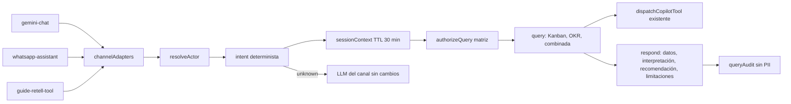
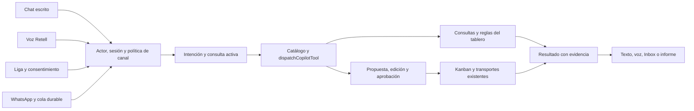

# Enviardián · arquitectura objetivo

## R1 · núcleo compartido implementado localmente · 2026-11-19

El núcleo **envuelve** el runtime existente; no lo reemplaza. `dispatchCopilotTool`, el catálogo, RLS, predicados SQL de R0, Retell y los transportes WhatsApp siguen siendo los mismos. Los canales sólo adaptan formato.

| Pieza | Contrato | Regla clave |
| --- | --- | --- |
| `api/_shared/query/contracts.ts` | `QueryRequest`, `QueryResult<T>`, `CombinedQueryResult` | `status` ∈ ok, empty, forbidden, partial, error. `partial` sólo cuando la fuente se truncó o una parte se denegó; recortar la lista mostrada es una limitación, no parcialidad. |
| `query/resolveActor.ts` | `AgentActor` | Identidad sólo de la sesión verificada (JWT, vínculo WhatsApp validado por RPC, sesión Guía). `stripAuthorityFields` descarta rol, IDs y alcance enviados por cliente o modelo. |
| `query/authorizeQuery.ts` | `AGENT_PERMISSION_MATRIX` | Guarda previa que nunca amplía: la lectura amplia reutiliza `canUseWideActionScope`; OKRs siguen sujetos al gate de módulo; `execute_write` es `disabled_r1` o `deny` para todos. Dirección: lectura sí, proponer/ejecutar no. |
| `orchestrator/runAgentTurn.ts` | `AgentTurnResult` | identidad → intención → contexto → autorización → consulta e interpretación → respuesta + auditoría + traza por etapa. `unknown` → `handled=false` y el canal sigue con su LLM. |
| `orchestrator/respond.ts` | `AgentResponse` | Cuatro bloques separados. La interpretación que no es dato se rotula como inferencia. Finanzas y otros dominios sin fuente se declaran limitación; nunca se estiman. |
| `actions/contracts.ts` y `actions/simulator.ts` | `ACTION_CONTRACTS`, `ActionProposal`, `buildIdempotencyKey` | R2 preparado: create_action, update_status, register_blocker y notify_responsable. Ejecución real `R1_EXECUTION_ENABLED=false`; la ejecución futura reutiliza `assistant_pending_ops` y `confirmPendingOp`. |

**Activación.** Los tres adaptadores están detrás de `AGENT_ORCHESTRATOR_R1=1`, apagado por defecto. WhatsApp sigue en sólo lectura: una intención de escritura no crea propuestas y continúa por el flujo existente. Voz sólo intercepta herramientas de lectura con `utterance`. Retell no cambia de configuración.

**Contexto en serverless.** El store es memoria por instancia: suficiente para pruebas y turnos consecutivos en la misma instancia. Para integración se necesita persistencia por sesión (para web/WhatsApp, `consult_log` o una tabla con TTL); queda registrado como dependencia de CV-02.

## Condiciones de estabilización R0 · 2026-11-19

No se añade arquitectura, motor ni capacidad de R1. Se conserva Dirección como consulta ejecutiva autorizada y se mantienen grants de administración y relaciones de escritura independientes. El cierre exige contrastar la migración candidata con **owners, EXECUTE, search_path, políticas restrictivas y triggers del esquema efectivo**, no sólo con el laboratorio reducido.

Staging reutilizará los dos proyectos y diez cuentas ya propuestos. QA-leader representa la función gerencial con un rol existente y relaciones explícitas; no se crean roles/grants por el nombre Gerencia. Las comprobaciones entre proyectos utilizan sesiones reales y claves independientes. No hay prueba real de ese aislamiento todavía.

La validación WhatsApp remota debe ejecutar el handler existente con transporte simulado y acceso limitado a los hosts QA: callback firmado, BD/cola reales de QA, worker, Inbox y estado delivered sintético. No se copian cron, Vault, usuarios, claves, sesiones ni datos de producción. La instrumentación separa queue_ms, processing_ms, provider_duration_ms y los estados de entrega; no se reconstruyen retrospectivamente etapas ausentes.

El rollback SQL vigente **verifica**, no deshace la migración. La recuperación operativa exige un artefacto de aplicación compatible con el piso de seguridad y conservar RLS, guards, ACL y search_path endurecidos. La prueba real de recuperación y el contraste con snapshot siguen NO-GO hasta staging. No se restaura la autorización legacy de Dirección.

## Validación controlada · recursos aún no autorizados

La base local de 480 pruebas está aprobada. El recorrido adicional webhook → cola → worker → Inbox → respuesta → entrega pasa con proveedores simulados (suite de 16 casos). No hay staging creado ni sesiones JWT reales de QA ejecutadas. El rollback vigente sólo verifica la base de seguridad; no restaura privilegios legacy. El 401 histórico y los dos P0001 continúan abiertos por evidencia causal inaccesible mediante REST. Véanse la [propuesta de recursos](release-plan.md), los [casos de aceptación](acceptance-tests.md) y los [límites de recuperación](risks-and-dependencies.md).

## Matriz aprobada y realizada localmente

Dirección tiene lectura ejecutiva de Kanban y OKRs del proyecto/organización autorizada y puede consultar al agente. La lectura no concede gestión de Inbox, WhatsApp, usuarios, catálogos, retos ni configuración. Las modificaciones y verificaciones requieren relaciones o asignaciones explícitas; el rol de Dirección no omite esos controles.

El catálogo y `dispatchCopilotTool` siguen siendo el núcleo. La autorización de escritura reutiliza `can_edit_accion_general_as` y `can_manage_accion_full_as` en propuesta y confirmación. Una nueva capacidad SQL de consulta de WhatsApp permite Dirección sin extender el gate existente de operaciones. La identidad continúa derivándose de la sesión y del vínculo de canal.

La entrada WhatsApp se guarda antes de ejecutar los routers existentes. Los metadatos se enriquecen sobre el ID Meta único. Se conservan los mismos transportes, cola, recibos y motor de intención. El seguimiento temporal separa espera en cola, trabajo del worker, petición Graph y timestamp de entrega.

La migración y el rollback están preparados. Su orden de promoción y sus dependencias figuran en [releases](release-plan.md). No se ha introducido un modelo multiempresa dentro de una sola base.

## Ciclo 2 · ajuste de estabilización

El objetivo mantiene el runtime existente. Se aplican tres correcciones locales previas a una eventual promoción: rechazar al dispatcher sin credencial válida, guardar respuestas AI como `automation` con `payload.source=webhook_ai_reply`, y propagar errores de envío al worker para que se registren en la cola. Los borradores heredados se excluyen del contexto tanto si proceden de `ai` como de `automation`. No hay cambios de políticas RLS, usuarios, esquema productivo, proveedores ni motor conversacional.

La QA propuesta utiliza proyectos aislados por organización sintética mientras el producto conserve aislamiento por proyecto. La matriz y los accesos deben aprobarse antes de crear entornos o ejecutar recorridos con identidades reales. El resultado esperado de Dirección/Comercial sobre OKR/AI se debe decidir antes de alterar guardas o criterios. Véase [configuración de QA](risks-and-dependencies.md).

Propuesta R0 para revisión. Conserva los modelos de datos, el catálogo, el runtime y las integraciones existentes. Los adaptadores de canal mantienen sus protocolos.

| Decisión propuesta | Reutilizar | Evidencia de aceptación |
| --- | --- | --- |
| Resolver actor y alcance en el servidor antes de cada herramienta o confirmación | `assistantAuth`, `guideUserLinks`, `user_channel_identities`, gates de `assistantBoardReads` | Cada actor recibe el alcance permitido según rol, módulo y canal. Vínculo ambiguo, revocado o ajeno termina con denegación redactada. |
| Usar un contrato de consulta activa con entidad, filtros, semántica de alcance y resultados | `operationalDictionary`, `actionQueryContract`, `mergeArgs` | «Todas» conserva responsable/creador y cambia únicamente el filtro acordado. La misma pregunta produce los mismos IDs y totales para el mismo actor. |
| Separar interacción de la evidencia estructurada | `dispatchCopilotTool`, `get_module_data`, `consult_log`, briefing y renderers existentes | La respuesta conserva procedencia, alcance, fecha de corte, total y paginación. El modelo puede resumir y verbalizar el resultado. |
| Separar consulta, propuesta y efectos externos | `assistant_pending_ops`, `assistant_op_log`, edición y confirmación existentes, RPCs de WhatsApp | Una consulta normal no bloquea por un borrador. Revalidar dueño, contenido y permisos en confirmación. Repetición y concurrencia producen un solo efecto verificable. |
| Adaptar voz, liga y WhatsApp sin duplicar el negocio | Tool firmada de Retell, grant de Guía, worker e Inbox | Cada superficie respeta sus capacidades. La liga pública deriva las aprobaciones al dueño autenticado. Las respuestas habladas incluyen resultado o error recuperable. |
| Conectar evidencia de operación y proveedor | Logs Retell/Gemini, IDs de cola, IDs Meta, estado de Vercel, logs de operaciones | Se reconstruye recepción → consulta → respuesta o confirmación → proveedor → entrega, con redacción de PII y métricas por canal. |
| Evolucionar conocimiento y producto sobre las lecturas existentes | Diccionario operativo, módulos del tablero, informe y recomendaciones | Fuentes versionadas con visibilidad y vigencia, sólo tras definir alcance documental y cubrir preguntas sin datos. |

## Orden de consolidación

1. Mapear precedencia de rutas y comparar fixtures por rol. Mantener las rutas factuales y los comandos existentes mientras se mide equivalencia.
2. Consolidar semántica y reglas reutilizables en el catálogo y runtime. Retell y Gemini conservan adaptación de turnos, síntesis y formato.
3. Unificar el contrato de borrador, estado y trazabilidad utilizando el almacenamiento y transportes actuales. Verificar por canal los bloqueos por permisos, reintentos y fallos de proveedor.
4. Añadir cobertura de conocimiento, recomendaciones y administración después de tener evidencia verificable y una política de alcance aprobada.

El motivo de cada transición y sus pruebas están en [plan de releases](release-plan.md) y [aceptación](acceptance-tests.md).
