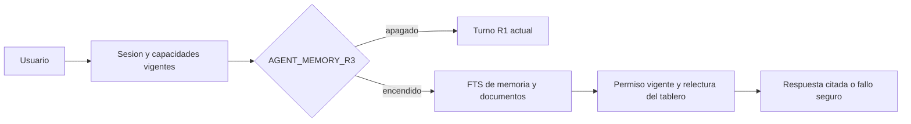

# R3 · plan de memoria, conocimiento y seguridad

Etapa 1 de [githubSkills.md](../prompts/githubSkills.md). Arquitectura propuesta el 2026-11-20. Todavía no hay código, migración ni flag en el repositorio.

La decisión de repositorios está en [r3-repo-evaluation.md](r3-repo-evaluation.md). Este documento fija cómo sería la POC local si se aprueba. Hasta esa aprobación las etapas 2 a 5 permanecen cerradas.

## Decisión

Memoria durable y documentos autorizados viven en Postgres, con la misma identidad y las mismas capacidades que el orquestador R1. Un flag nuevo, `AGENT_MEMORY_R3`, nace apagado y es independiente de `AGENT_ORCHESTRATOR_R1` y de `R1_EXECUTION_ENABLED`.

`agent_session_context` sigue siendo el contexto corto del turno (IDs, 30 minutos, huella de capacidades). R3 es otro almacén: acuerdos, decisiones, preferencias operativas y pendientes que una persona confirmó. El estado de una acción o de un KR se lee siempre del tablero.

Con el flag apagado el turno no consulta esas tablas y no escribe en ellas. Encenderlo en un entorno alojado queda fuera de esta etapa.

## Qué se conserva y qué se descarta

| Merece guardarse | Cuándo | Confirmación |
| --- | --- | --- |
| Acuerdo de reunión («retraso de logística: revisar el proveedor el viernes») | El usuario pide recordarlo o acepta la propuesta del agente | Sí, antes de pasar a `confirmed` |
| Decisión de proyecto con fuente («se aplaza el corte de marzo») | Queda dicho como decisión y el usuario la confirma | Sí |
| Preferencia operativa autorizada («respuestas cortas», «zona America/Mexico_City») | El usuario la declara para su propio alcance | Sí, y solo dentro de lo que su rol ya puede hacer |
| Pendiente de seguimiento | Hay un responsable y un recordatorio, sin mutar la acción | Sí |

No se guarda el transcript completo, ni tokens, ni payloads de WhatsApp, ni teléfonos en claro, ni el texto de una herramienta, ni una copia del estado de Kanban u OKR. Una fila `proposed` que nadie confirma caduca y no entra en la recuperación.

Corregir es una versión nueva que apunta a la anterior (`supersedes_id`). Borrar marca la fila `deleted` y la excluye de la búsqueda. La fila anterior no se reescribe en silencio.

## Modelo propuesto

Aislamiento de organización: el producto separa organizaciones por proyecto Supabase. Esta POC no inventa una columna tenant. Dos organizaciones sintéticas son dos bases locales, o dos fixtures que el harness no mezcla. Dentro del proyecto, el alcance usa `usuario_id`, el área y las capacidades ya derivadas (`readAllOkrs`, `readCrossAreaExecution`, módulos).

### Memoria

| Campo | Uso |
| --- | --- |
| `id` | Identificador único |
| `usuario_id` | Autor. La RLS parte del dueño y del usuario activo, igual que `agent_session_context` |
| `area_id` | Opcional. Amplía la lectura solo si la capacidad vigente ya permite ese ámbito |
| `memory_type` | `agreement`, `decision`, `preference`, `follow_up` |
| `body` | Texto acotado (propuesta: 2 KB). Se rechazan patrones de token, claves y teléfonos |
| `source_kind` / `source_ref` | `session`, `document` o `manual`, más hash de sesión o id de versión del documento. Nunca el id de canal en claro |
| `content_hash` | Deduplicación entre filas `confirmed` del mismo tipo y alcance |
| `validation_status` | `proposed`, `confirmed`, `rejected`, `superseded`, `deleted` |
| `access_level` | Techo: `owner`, `area`, `project_read`. No concede un permiso que las capacidades nieguen |
| `version` / `supersedes_id` | Corrección trazable |
| `created_at` / `updated_at` / `expires_at` | Vigencia. `expires_at` nulo significa «hasta que se borre o se sustituya» |
| `confirmed_by` / `confirmed_at` | Quién aceptó la fila |

Índice de recuperación previsto: `to_tsvector('spanish', body)` sobre filas `confirmed`, no vencidas y no borradas. Sin embeddings en la POC.

### Documentos

| Campo | Uso |
| --- | --- |
| `id`, `title`, `body` | Procedimiento o política autorizada. El cuerpo tiene tope (propuesta: 32 KB por versión) |
| `version` | Entero creciente por documento lógico |
| `status` | `published` o `withdrawn`. Solo `published` se recupera |
| `access_level` | Mismo techo que la memoria, revalidado en cada lectura |
| `content_hash`, `published_at`, `withdrawn_at` | Integridad y baja |
| `source_label` | Nombre interno del procedimiento, para la cita |

La ingesta de la POC es un fixture sintético cargado por la prueba, no un cargador abierto al usuario ni a un bucket remoto. El orden cuando exista ingesta real:

1. Una persona con capacidad de publicación autoriza el documento.
2. Se fija el proyecto (la base) y, si aplica, el área.
3. Se clasifica el `access_level`.
4. Se indexa la versión publicada.
5. La búsqueda filtra por la RLS y por las capacidades del turno.
6. Antes de responder se vuelve a comprobar el permiso y que la versión siga `published`.
7. La respuesta cita id, título, versión y fecha.
8. Retirar o sustituir la fuente pasa la versión anterior a `withdrawn` o publica una versión nueva. La búsqueda deja de ver la retirada.

El texto recuperado entra al modelo como dato, dentro de un bloque delimitado. No es instrucción de sistema y no puede disparar herramientas.

## Integración prevista con el orquestador

El flujo R1 se mantiene: identidad, intención, contexto de sesión, autorización, consulta, respuesta, auditoría. R3 se inserta solo si el flag está en `1`, después de la autorización y antes de redactar la respuesta.

| Regla | Comportamiento |
| --- | --- |
| Fuente de verdad | Kanban y OKRs salen de `dispatchCopilotTool`. La memoria aporta el acuerdo; el tablero aporta el estado de hoy |
| Alcance | La consulta de memoria usa el mismo actor canónico. `stripAuthorityFields` sigue descartando rol y alcance que lleguen del cliente o del modelo |
| Revocación | El permiso se evalúa al leer. Un cambio de rol, área o módulo deja fuera lo que el techo ya no cubre, aunque la fila siga `confirmed` |
| Lecturas | Recuperar memoria o un documento no inserta, no actualiza y no borra |
| Acciones de tablero | Siguen el ciclo R2 de propuesta, confirmación, revalidación y recibo. `execute` continúa deshabilitado en R1. R3 no lo enciende |
| Fallo del almacén | Error, timeout o flag incoherente: se omite el bloque de memoria, se declara la limitación y se responde con el tablero si la consulta operativa sí respondió. No se inventa el acuerdo |
| Secreto | La auditoría de R3, como `queryAudit`, guarda ids y códigos, no el cuerpo ni PII |
| Canales | Web, WhatsApp y voz pasan por el mismo orquestador. No hay pantalla nueva |

`AGENT_MEMORY_R3` solo acepta el valor `1`. Cualquier otro valor, incluido ausente, lo deja apagado. Apagarlo devuelve el turno al camino R1.

## Experiencia en el chat

Respuestas cortas: acuerdo o procedimiento, origen, estado vivo si existe, y una siguiente acción que no se ejecuta sola.

**Caso A — Seguimiento.** «¿Qué acordamos sobre el retraso de logística?» Recupera el acuerdo `confirmed` visible para ese actor, cita sesión o documento y versión, y relee las acciones de logística en el tablero antes de decir si siguen abiertas.

**Caso B — Conocimiento.** «¿Cuál es el procedimiento para verificar una tarea?» Recupera la versión `published`, enumera los pasos y cita id y versión. Si el documento trae una cifra de avance, esa cifra no sustituye al KR del tablero.

**Caso C — Contexto.** «Retomemos lo que vimos en la última sesión.» Lista acuerdos `confirmed` de sesiones a las que este actor todavía puede acceder y propone continuar. No crea acciones ni envía mensajes.

**Caso D — Seguridad.** Un usuario pide el acuerdo o el procedimiento de otro proyecto o de un ámbito que su capacidad niega. La respuesta es una denegación genérica. No incluye título, fragmento, hash ni un «existe pero no puedes verlo».

## Matriz de funcionalidades y dependencias

| Función | Depende de | No depende de | Etapa |
| --- | --- | --- | --- |
| Contexto de 30 min | `agent_session_context`, flag R1 | R3 | Ya en R1. No se modifica |
| Memoria confirmada | Tabla nueva, RLS, flag R3, fixture sintético | Agent Memory, embeddings | 2, tras aprobación |
| Documentos citados | Tabla de versiones, FTS, mismas capacidades | OpenViking | 2 |
| Unión al turno | `runAgentTurn` detrás del flag | Cambiar el contrato de `QueryResult` | 3 |
| Aislamiento, inyección, regresión | Harness actual (`r1Fixture`, PGlite) | JWT remoto, DEV, PROD | 4 |
| Decisión de alojar | Resultados de la etapa 4 | Esta etapa | 5 |

R3 depende de que la autorización R1 siga siendo la única. No depende de cerrar R0 para escribir estos documentos. Sí depende de R0 y del freeze de R1 para cualquier integración o entorno alojado: eso sigue NO-GO.

## Inventario de cambios de esta etapa

| Cambio | Estado |
| --- | --- |
| `docs/agent/r3-repo-evaluation.md` | Creado |
| `docs/agent/r3-memory-knowledge-security-plan.md` | Creado |
| `docs/agent/r3-threat-model.md` | Creado |
| `docs/agent/r3-acceptance-tests.md` | Creado |
| Código del orquestador, flags, `package.json`, migraciones, suites | Sin cambios |

## Etapas siguientes (cerradas)

| Etapa | Entra cuando | Se detiene si |
| --- | --- | --- |
| 2 · POC local | Se aprueba este plan | Hace falta un segundo motor, una dependencia de pago o una escritura en el camino de lectura |
| 3 · Integración aislada | La POC pasa los casos de memoria y documentos en el harness | El flag apagado altera una respuesta R1 |
| 4 · Seguridad y QA | La integración está detrás del flag | Aparece cruce de organización, fuga en la denegación o una escritura de tablero |
| 5 · GO / NO-GO de validación alojada | Hay métricas de la etapa 4 | Sigue abierto R0, o la POC no muestra un acuerdo útil distinto del tablero |

## Riesgos y costos de la arquitectura elegida

| Riesgo | Efecto | Contención prevista |
| --- | --- | --- |
| Tratar la memoria como estado del tablero | El agente responde un acuerdo viejo como si la acción ya estuviera cerrada | Relectura obligatoria. El acuerdo no escribe `acciones_diarias` ni OKRs |
| Segunda política de acceso mal copiada | Un usuario lee el acuerdo de otra área | RLS más revalidación con las capacidades del turno. El `access_level` es un techo |
| Texto hostil dentro de un procedimiento | El modelo obedece una instrucción embebida | Bloque de dato no confiable. Las herramientas de escritura siguen en confirmación humana |
| FTS en español insuficiente | No recupera un parafraseo | Aceptable en la POC. Embeddings solo si la etapa 4 muestra un fallo de recuperación que el FTS no cubre, con aprobación aparte |
| Coste | Filas pequeñas y un recorte de hasta 800 tokens por turno cuando el flag esté encendido | Cero con el flag apagado. Sin proveedor nuevo |

El detalle de amenazas está en [r3-threat-model.md](r3-threat-model.md).

## Recomendación

**NO-GO** para instalar Agent Memory, OpenViking o skills, y para preview, DEV o PROD.

**GO condicionado** para la etapa 2: tablas locales, fixtures sintéticos y pruebas del harness, con `AGENT_MEMORY_R3` ausente en todo entorno compartido. Ese GO no está concedido por este documento; hace falta una aprobación explícita sobre esta arquitectura.
