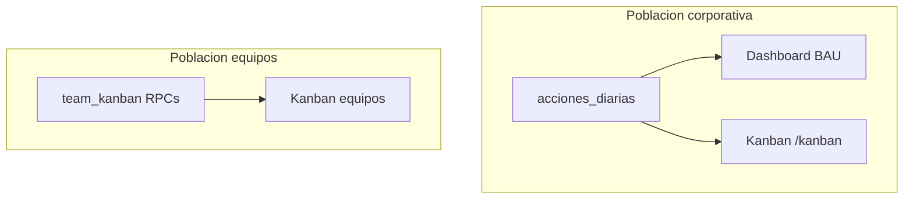

# Auditoría de consistencia: Dashboard ↔ Kanban ↔ Equipos

## Hallazgo arquitectónico

Las tres pantallas **no consultan el mismo universo de datos**.

| Vista | Ruta | Fuente | Población |
|---|---|---|---|
| Dashboard BAU | `/dashboard` | `useAcciones` → `acciones_diarias` | `acciones_corporativas` |
| Kanban general | `/kanban` | `useAcciones` → `acciones_diarias` | `acciones_corporativas` |
| Tablero equipos | `/kanban-equipos/tablero` | RPCs `team_kanban_*` | `acciones_equipo` |

**Regla:** conciliar IDs y métricas solo dentro de la misma población. Entre poblaciones la diferencia es **justificada**.

---

## Matriz de fuentes

| Elemento | Dashboard BAU | Kanban general | Tablero equipos |
|---|---|---|---|
| Fuente de datos | `acciones_diarias` vía `acciones.service` / `useAcciones` | Igual | RPCs `team_kanban_board`, `team_kanban_my_areas`, etc. |
| Tabla / RPC | Tabla `acciones_diarias` (RLS usuario) | Igual | Funciones `team_kanban_*` (scope por área) |
| Filtros | `AccionesFilter` (área, responsable, fechas, `es_okr`) | Igual + default `es_okr: false` | Área, asignado, estado, prioridad, “solo mías” |
| Estados | Catálogo `ACTION_STATUS` | Columnas Kanban + auto `Retraso` | Estados del board (`estado_id`, `es_final`) alineados al catálogo corporativo |
| Cálculos | `useOperationalDashboardMetrics` → `corporateActionMetrics` | `kanbanHealthFromAcciones` → `corporateActionMetrics` | `teamDashboardMetrics` → `teamActionMetrics` |
| Actualización | React Query `['acciones']`, `staleTime` 30s, invalidate en mutaciones | Igual | React Query `teamKanbanQueryKeys`, patch optimista + invalidate |
| Realtime | No (refetch / invalidación) | No | No (refetch / patch local) |

### Archivos clave

- Dashboard: `src/pages/dashboard/DashboardPage.tsx`, `hooks/useOperationalDashboardMetrics.ts`, `components/BauDashboardOverview.tsx`
- Kanban: `src/pages/kanban/KanbanPage.tsx`, `src/features/operations/utils/metricas.ts`
- Equipos: `src/features/team-kanban/TeamKanbanPage.tsx`, `service.ts`, `utils/teamDashboardMetrics.ts`
- Fórmulas canónicas: `src/features/metrics/corporateActionMetrics.ts`, `src/features/metrics/teamActionMetrics.ts`

---

## Estados canónicos (corporativo)

Definidos en `src/types/enums.ts`:

`Pendiente` · `Hoy` · `En_Ejecucion` · `Bloqueado` · `Retraso` · `Hecho` · `Verificado`

### Definiciones operativas compartidas

| Concepto | Definición | Fuente de verdad |
|---|---|---|
| Abierta | Estado distinto de `Hecho` y `Verificado` | `isCorporateOpen` |
| Cerrada (conteo operativo) | `Hecho` o `Verificado` | `!isCorporateOpen` |
| Pendiente de verificación | Estado `Hecho` (no es Verificado) | `isPendingVerification` |
| Verificada | Estado `Verificado` | `isCorporateVerified` |
| Bloqueada | Abierta y estado `Bloqueado` | `isCorporateBlocked` |
| Vencida | Abierta, no bloqueada, columna Kanban `Retraso` (fecha + `hora_limite` CDMX) | `isCorporateOverdue` |
| Edad de rojos | Solo `Verificado` cierra el reloj; `Hecho` sigue contando | Dashboard / `kanbanHealthFromAcciones` (explícito) |

**Hecho ≠ Verificado.** No sumar ambos como “trabajo verificado”.

### Equipos (población distinta)

| Concepto | Definición |
|---|---|
| Abierta | Sin `completed_at` y estado no `es_final` |
| Vencida | Abierta y `fecha_limite` timestamptz `< now` (`isTeamDeadlinePast`) |
| Bloqueada | Flag `bloqueada` o nombre de estado con “bloque” |

La regla de vencimiento de equipos **no** usa `hora_limite` del Kanban corporativo.

---

## Alcance por defecto

| Vista | Universo por defecto |
|---|---|
| Dashboard BAU | Acciones corporativas operativas (`es_okr: false`), organización visible por RLS |
| Kanban | Igual (`es_okr: false`); analista fuerza `responsable = yo` |
| Equipos | Acciones del área seleccionada (`acciones_equipo`) |

Etiqueta corporativa: `formatCorporateScopeLabel` →  
`Acciones corporativas · horario CDMX · {área} · {responsable} · {periodo}`

Etiqueta equipos: `Acciones de equipo · {área}`

---

## Sincronización

- Mutaciones corporativas invalidan `['acciones']` → Dashboard y Kanban comparten caché React Query (`useAccionMutations`).
- `staleTime`: 30 segundos (`useAcciones`).
- No hay canal realtime corporativo; al volver a la vista o tras mutación se refetch. Retraso máximo esperado ≈ staleTime si no hubo mutación local.
- Equipos: patch optimista del board + invalidate de `teamKanbanQueryKeys`.

---

## Matriz de aceptación

| Indicador | Dashboard | Kanban | Equipos | Estado |
|---|---|---|---|---|
| Abiertas | `isCorporateOpen` | igual | otra población | Coincide (corp) / Justificada (equipos) |
| Vencidas | `isCorporateOverdue` | igual | `isTeamDeadlinePast` | Coincide (corp) / Justificada (equipos) |
| Bloqueadas | `isCorporateBlocked` | igual | flag/estado equipo | Coincide (corp) / Justificada (equipos) |
| Pendiente verificación | `Hecho` | misma definición | N/A o cierre `es_final` | Coincide definición corp |
| Verificadas | no sumar con Hecho | igual | `completed_at` / final | Coincide definición |
| Universo `es_okr` | default `false` | default `false` | N/A | Coincide (corp) |
| Totales Dashboard vs Equipos | — | — | distintas tablas | Diferencia justificada |

### Correcciones aplicadas en esta auditoría

| Cambio | Causa raíz | Resultado |
|---|---|---|
| Dashboard default `es_okr: false` | Universo distinto al Kanban | Coincide |
| Core metrics / kanbanHealth delegan a `corporateActionMetrics` | Fórmulas duplicadas | Coincide |
| Etiquetas de alcance en Dashboard y Kanban | Métricas sin contexto de población | Corregido |
| Etiquetas “Acciones de equipo” | Confusión visual con corporativo | Justificada y visible |
| Helper `reconcileActionIds` + tests | Conciliación solo por totales | Corregido y verificado |

---

## Criterio de éxito

1. Mismos filtros corporativos → mismos IDs en abiertas / vencidas / bloqueadas / pendiente verificación.
2. Hecho y Verificado no se confunden.
3. Equipos etiquetado como población distinta.
4. Pruebas de regresión en `corporateActionMetrics.test.ts` en verde.
