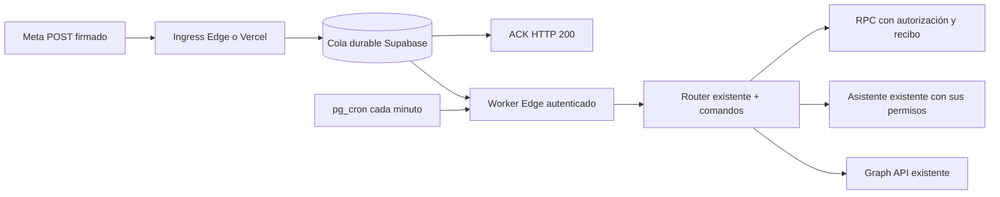

# WhatsApp bidireccional: auditoría y reparación

Fecha: 17 de noviembre de 2026, America/Mexico_City. Cambios locales preparados; **no desplegados, sin migraciones remotas y sin envíos reales**.

## Evidencia y causa raíz

La consulta pública al endpoint `https://xhpasmjzuwifmjhrsumb.supabase.co/functions/v1/whatsapp-webhook` devolvió HTTP **503**, código **BOOT_ERROR**: la función no arranca. El código anterior contenía declaraciones superiores duplicadas de `CHANNEL_SELECTOR_DEBOUNCE_MS`, `VOICE_LINK_RESEND_COOLDOWN_MS`, `channelSelectorFallbackText` y `extractVoiceLinkFromPayload`. La ejecución local reproducía el fallo de sintaxis; las duplicaciones se eliminaron y el bundle ahora compila. Es una causa concreta del fallo local y una explicación compatible con el fallo remoto. Sin logs ni versión desplegada no se puede atribuir con certeza ese BOOT_ERROR remoto a la misma revisión.

El endpoint alternativo `https://scrumbanemx.vercel.app/api/whatsapp-webhook` respondió GET 200 `ok`. Esto no demuestra recepción POST, firma válida ni respuesta al usuario.

Lecturas remotas realizadas con la configuración existente, sin modificarla:

- WABA: una aplicación suscrita, sin override de callback; teléfono configurado `CONNECTED`.
- 57 registros históricos entrantes: 28 textos, 18 interactivos, 9 botones, 2 imágenes. Último registro observado: `2026-11-17T16:31:35.511234Z`.
- Últimos 100 registros del inbox: 39 entrantes; 61 salientes (4 sent, 41 delivered, 16 read). Esto demuestra actividad histórica, no funcionamiento de esta reparación.
- 29 trabajos de seguimiento: 14 enviados, 3 fallidos, 12 cancelados.
- La consulta de suscripciones de la aplicación devolvió error Meta 104 con el token disponible. **Callback efectivo, suscripción del campo messages, modo de la aplicación y logs desplegados quedan pendientes**.

Además del arranque, el código anterior reconocía eventos antes de completar trabajo síncrono, podía perder reintentos, permitía firma ausente según configuración y no centralizaba permisos de mutación. La reparación aborda estos puntos, no sólo el prompt.

## Arquitectura y archivos

Hay un único procesador de negocio. Vercel queda como ingress compatible hacia la misma cola, no como una segunda integración. Elegir un solo callback en Meta.

| Archivos | Cambio |
|---|---|
| `src/lib/whatsappIngress.ts` | GET challenge, HMAC SHA-256 sobre cuerpo original, validación WABA/teléfono, normalización separada de mensajes y estados, ACK después de persistir |
| `api/whatsapp-webhook.ts` | Adaptador de cuerpo crudo Node; rechaza cuerpos ya parseados; sólo encola |
| `supabase/functions/whatsapp-webhook/index.ts` | Arranque corregido, ingress y worker, comandos antes de evidencia/IA, sesiones, selección explícita, motivo de bloqueo, permisos, errores seguros |
| `src/lib/whatsappCommands.ts` | Hola/Ayuda, Mis acciones, Vencidas, Asignadas, Actualizar acciones, Cancelar |
| `supabase/migrations/20261117180000_whatsapp_durable_inbound.sql` | Cola, leases, deduplicación, recibos, mutaciones atómicas corporativas y de equipo, RLS y permisos de RPC |
| `supabase/scripts/schedule_whatsapp_inbound_worker.sql` | Programación explícita del worker con Vault; no se ejecutó remotamente |
| `supabase/scripts/audit_whatsapp_inbound.sql` | Diagnóstico administrativo sin cuerpos ni teléfonos |
| `scripts/sync-whatsapp-routing.mjs`, `scripts/bundle-whatsapp-dashboard.mjs` | Sincronización del código compartido y validación/bundle del webhook |
| `src/lib/whatsappIngress.test.ts`, `api/whatsapp-webhook.test.ts`, `api/_shared/whatsappMetaSignature.test.ts`, `api/_shared/whatsappEdgeRuntime.test.ts` | Pruebas sobre implementación real, con transportes simulados |
| `tests/fixtures/whatsapp/text.json`, `scripts/test-whatsapp-database.mjs`, `vitest.whatsapp.config.mjs` | Fixture anónimo, pruebas SQL aisladas y configuración reproducible |

No se modificaron los implementadores salientes `whatsapp-send-action`, `whatsapp-followup-dispatcher`, `whatsapp-inbox` ni el asistente conversacional existente. Sus bundles se validaron, pero su entrega real no se volvió a probar.

## Comportamiento y garantías

- Usuario: resolución inequívoca de identidad vinculada y usuario activo. Número desconocido recibe instrucción de vinculación; una coincidencia ambigua no concede acceso.
- Comandos deterministas no requieren IA. Las consultas abiertas conservan el asistente existente; no se afirmó haber consultado datos de negocio mediante IA en producción.
- Las listas guardan candidatos y seleccionan por UUID, no por posiciones ambiguas. Sesión de 30 minutos; Cancelar expira también las solicitudes de evidencia. Comandos y consultas cambian de intención antes de capturar evidencia o motivos.
- «Realizada» lleva a **Hecho**, nunca Verificado. Completar un checkpoint sólo cierra la acción cuando no quedan checkpoints activos pendientes. Equipo usa el estado exacto Hecho, no cualquier estado de cierre.
- «Requiero apoyo» solicita primero el motivo. Luego guarda bloqueo y comentario en una transacción. Las mutaciones vuelven a comprobar usuario activo y responsable/asignado bajo bloqueo de fila, incluso al ejecutar con service role.
- Al completar, se cancelan seguimientos pendientes correspondientes. Un seguimiento ya en ejecución por el dispatcher existente puede haber cruzado el límite de envío; esta reparación no cancela una llamada externa ya realizada.
- IDs de eventos únicos evitan encolar duplicados. Un lease serializa el procesamiento por teléfono/remitente. Un recibo transaccional hace idempotente la actualización de negocio.
- Fallos previos a efectos: reintento con espera creciente, máximo cuatro intentos. Efectos iniciados o resultado incierto del proveedor: estado `review`, sin reenvío automático. `review` detiene mensajes posteriores de ese remitente para evitar actualizaciones fuera de orden.
- No se promete exactamente una entrega externa ante una caída entre Meta y la persistencia local. Resolver `review` exige revisar logs, ID Meta, inbox y recibos antes de decidir. No resetear masivamente estos trabajos. Si se confirma entrega/actualización, cerrarlos administrativamente con auditoría; sólo reencolar tras demostrar que no hubo efectos.
- El esquema existente no implementa una columna universal de organización. El límite es proyecto Supabase + WABA/teléfono configurados + autorización del usuario y propietario. Se rechazan otras WABA/teléfonos y acciones ajenas; esto **no certifica aislamiento multiempresa general**.

## Configuración y orden de activación (pendiente de autorización)

1. Confirmar el proyecto y revisar la migración contra su esquema real. Requiere las tablas existentes de usuarios, acciones, checkpoints, estados, comentarios, sesiones, solicitudes de resultado y seguimientos. Aplicar **sólo la migración de esta reparación**, no todas las migraciones pendientes del workspace. Primero probar en staging con copia de esquema. PGlite utilizó un esquema representativo, no una réplica íntegra de producción.
2. Configurar secretos Edge: `WHATSAPP_APP_SECRET`, `WHATSAPP_VERIFY_TOKEN` (alias anterior `token_de_verificacion`), `WHATSAPP_PHONE_NUMBER_ID`, `WHATSAPP_WABA_ID` o `WHATSAPP_BUSINESS_ACCOUNT_ID`, `WHATSAPP_ACCESS_TOKEN`, `WHATSAPP_DISPATCHER_SECRET`. Supabase aporta URL/service role al runtime. Para IA conservar `WHATSAPP_AI_ENABLED`, `APP_URL` y `WHATSAPP_ASSISTANT_SECRET`, coherentes con Vercel. No colocar secretos en variables VITE públicas. Ausencia local de un secreto no prueba ausencia remota.
3. Ejecutar localmente `node scripts/sync-whatsapp-routing.mjs` y `node scripts/bundle-whatsapp-dashboard.mjs`. Tras autorización, desplegar el webhook al proyecto confirmado con JWT de plataforma deshabilitado (`--no-verify-jwt`): el POST público se autentica por HMAC; `?worker=1` exige `x-dispatcher-secret`. No desplegar otras funciones sin necesidad. Alternativa Dashboard: bundle generado `dist/supabase-dashboard/whatsapp-webhook/index.ts`.
4. Crear/verificar en Vault `whatsapp_inbound_url` apuntando al webhook del **mismo proyecto** con `?worker=1`, `whatsapp_dispatcher_secret` con el mismo secreto del runtime y `supabase_anon_key`. Ejecutar el script de programación incluido. Verificar pg_cron y pg_net. El worker procesa hasta cinco eventos por invocación; latencia inicial de hasta un minuto, más espera si hay cola. **Sin cron activo el ingress confirma recepción, pero no habrá respuestas.**
5. Si Meta usa Vercel, desplegar también su ingress. Variables servidor: URL/service role Supabase según configuración existente (`SUPABASE_URL` o `VITE_SUPABASE_URL`, `SUPABASE_SERVICE_ROLE_KEY`), app secret, verify token, phone y WABA anteriores. Conservar el build `npm run vercel-build`. No activar body parsing sobre esta ruta ni bloquearla con Deployment Protection. Una prueba GET no valida el cuerpo crudo POST en el despliegue.
6. En Meta, abrir la aplicación asociada al WABA y comprobar Webhooks/WhatsApp: callback HTTPS elegido, verify token idéntico al servidor, objeto WhatsApp Business Account y campo **messages** suscrito. Verificar modo/publicación y permisos del token según el tipo de cuenta. La app ya aparece suscrita al WABA: inspeccionar antes de volver a suscribir; no se ejecutaron escrituras Meta. App secret y verify token son valores distintos con propósitos distintos.
7. Validar GET challenge con token válido (200 y challenge literal), inválido (403); POST firmado inválido (401). La firma correcta debe persistir y devolver 200; una falla de persistencia debe devolver 503. Después observar worker y prueba controlada de abajo.

Referencias: [verificación y firma de Webhooks Meta](https://developers.facebook.com/docs/graph-api/webhooks/getting-started/), [suscripciones WABA](https://developers.facebook.com/documentation/business-messaging/whatsapp/reference/whatsapp-business-account/subscribed-apps-api), [runtime de Functions Vercel](https://vercel.com/docs/functions/functions-api-reference).

## Pruebas y límites

Ejecución: `node node_modules/vitest/vitest.mjs run --config vitest.whatsapp.config.mjs --configLoader native`. Resultado: **94 pruebas, 10 archivos, todas pasan**. No hay red real en estas pruebas. La prueba de worker ejecuta el código Edge, reclama un trabajo simulado, responde Hola una vez y finaliza con su lease; otra rechaza llamadas sin secreto; los estados de entrega no generan respuesta.

`scripts/test-whatsapp-database.mjs` pasa con PGlite instalado externamente; requiere `WHATSAPP_PGLITE_PATH` apuntando a su módulo `dist/index.js`. Valida reaplicación de migración, mutaciones, autorización, idempotencia, leases, reintentos, revisión y denegación de roles cliente. No prueba pg_cron/pg_net ni concurrencia entre procesos PostgreSQL reales.

`npm run build`, `node scripts/bundle-api.mjs`, bundle de las cuatro funciones WhatsApp y lint del ingress/normalizador/comandos/pruebas de firma: correctos. La suite general detectó fallos fuera del cambio: cuatro en futureDateValidation, dos en moduleAccess y uno en actionGamification. No se ocultaron ni modificaron esas reglas en esta tarea.

| Casos solicitados | Evidencia local / pendiente |
|---|---|
| 1–4 GET, POST, firma válida/inválida | Ingress y adaptador Node; verificación sobre cuerpo original |
| 5–6 estado y texto | Normalización y ejecución Edge; estado sin respuesta |
| 7–8 Hola, Mis acciones | Comandos + ejecución Edge |
| 9–11 plantilla, botón, lista | Payloads normalizados, plantilla y selección de lista ejecutadas con mocks |
| 12–14 reconocido, desconocido, otra organización | Identidad activa/ambigua y desconocida; WABA/teléfono ajenos rechazados; propietario ajeno rechazado por SQL. Límite multiempresa explicado arriba |
| 15–17 selección, Hecho, bloqueo | Selección/sesión en Edge; autorización y actualización atómica en SQL; motivo solicitado antes de mutación |
| 18 respuesta a recordatorio | Contexto preservado y resolución implementada por ID de entrega/usuario/ventana; flujo completo real pendiente |
| 19–22 duplicado, reintento, error DB/proveedor | Cola SQL, leases, adaptador 503, excepciones DB y proveedor incierto sin segundo envío |
| 23–24 intención, expiración | Comando cancela captura, Cancelar expira evidencia, selección vencida rechazada |
| 25 consulta conversacional | Se conserva ruta existente sin capturar consulta como evidencia; respuesta real de IA pendiente |
| 26 envío de respuesta | Graph simulado, una respuesta en worker. Entrega real pendiente |

## Prueba con número autorizado

Sólo después de autorizar despliegue y envíos: elegir usuario de prueba activo, vincular su número y crear una acción/checkpoint de prueba propios. No usar acciones reales para ensayar cambios de estado.

1. Enviar una plantilla existente al número autorizado. Confirmar ID Meta y delivered/read; comparar con el comportamiento saliente previo.
2. Responder Hola y Mis acciones. Observar un trabajo por mensaje, su correlación en logs, transición pending → processing → done e ID de respuesta. No copiar teléfonos, tokens ni cuerpos a reportes públicos.
3. Pulsar botón de plantilla y Actualizar acciones; seleccionar una acción. Marcar Realizada y verificar Hecho, no Verificado, recibo único y cancelación de seguimientos pendientes. Para acción con varios checkpoints, verificar que sólo se cierra al completar todos.
4. En otra acción de prueba, pulsar Requiero apoyo: antes del motivo no debe cambiar estado. Escribir motivo; comprobar bloqueo/comentario. Repetir para checklist de equipo con estados configurados.
5. Responder al recordatorio citado «En proceso» y comprobar que se actualiza su acción, no otra reciente. Probar recordatorio expirado y cambio de propietario: deben impedir modificación.
6. Enviar una consulta abierta autorizada; verificar que llega al asistente con identidad correcta y devuelve información permitida. Mientras espera evidencia, enviar Mis acciones/Cancelar: no debe guardar ese texto como evidencia.
7. Ensayar expiración en staging y payloads duplicados firmados del entorno de prueba: una mutación y una respuesta; no reproducir payloads de producción. Fallos del proveedor y DB se inyectan en staging, nunca rompiendo credenciales de producción.
8. Consultar `supabase/scripts/audit_whatsapp_inbound.sql`, logs Edge/Vercel y resultados HTTP de pg_net. No basta que cron diga succeeded: comprobar HTTP 200 del worker y trabajo done. Resolver review/failed individualmente.

Quedan sin certificar: callback realmente configurado, logs/versión desplegada, permisos y modo Meta, cron remoto, respuesta real del asistente, regresión saliente real y recorrido extremo a extremo. Hasta completar esos pasos no se declara resuelto en producción.
